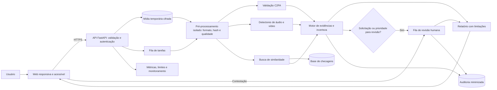

# VerificaBR — Plataforma de triagem de deepfakes e verificação de proveniência de conteúdo eleitoral

## Integrantes

| Nome completo | GitHub | Área de carreira | RGM |
|---|---|---|---|
| Albert dos Santos Mariano | @AlbertdosSantosMariano | Engenharia de Dados | 47857927 |
| Gabriel Anjos Albuquerque | @Nerd8im | Engenharia de Dados | 48037931 |
| João Pedro Theodoro de Sousa Andrade | @jp-theodoro | Ciência de Dados | 47863251 |
| Petterson Michel Lima Aguilar | @PettersonAguilar | Engenharia de Dados | 47859792 |
| Samuel Carmoni de Oliveira | @carmonisamuel-cloud | Cibersegurança | 47813733 |

**Dossiê:** 4 — Deepfakes e proveniência de conteúdo.

**Recorte:** triagem de áudios e vídeos de caráter político-eleitoral compartilhados em redes sociais e aplicativos de mensagens no Brasil. O recorte é viável porque se limita à análise de arquivos enviados voluntariamente, a fontes de checagem publicamente disponíveis e a um piloto com capacidade controlada. Não pressupõe acesso às mensagens privadas ou parceria já firmada com plataformas.

O projeto propõe conceitualmente o **VerificaBR**, uma aplicação web acessível que reúne validação de credenciais de origem, análise probabilística de sinais de manipulação, busca de checagens anteriores e revisão humana. O objetivo é auxiliar o usuário a tomar decisões informadas, sem acusar automaticamente alguém de mentir ou fabricar uma mídia. Uma assinatura válida não comprova a verdade de uma declaração; a ausência de assinatura não comprova falsificação. A proposta ainda **não foi implementada nem validada em produção**.

## 1. Análise do problema

**Responsável:** Gabriel Anjos Albuquerque

### 1.1 Quem é afetado, onde e quanto

Os deepfakes podem afetar diferentes grupos sociais, especialmente quando são utilizados para simular declarações, divulgar acontecimentos inexistentes ou manipular a percepção pública.

**Grupos potencialmente afetados:**

- Eleitores expostos a conteúdos políticos manipulados.
- Pessoas idosas e usuários com menor familiaridade digital.
- Jornalistas e profissionais de checagem.
- Pessoas que tiveram imagem ou voz falsificadas.
- Plataformas digitais e aplicativos de mensagens.
- Instituições públicas, incluindo a Justiça Eleitoral.

**Contexto brasileiro:**

Um levantamento de 2026 da Data Privacy Brasil e do Aláfia Lab registrou 413 casos de uso de inteligência artificial em publicações políticas entre janeiro e agosto de 2026, incluindo 336 envolvendo manipulações de imagem ou áudio de pessoas públicas.

Fonte: Data Privacy Brasil — IA na pré-eleição de 2026 (R01).

Esses números correspondem ao monitoramento citado, não a uma estimativa de todos os deepfakes existentes no país.

**Dados quantitativos de estudos recentes (monitoramento de 2026):**

| Levantamento | População observada | Principais números |
|---|---|---|
| Observatório IA nas Eleições, da Data Privacy Brasil e do Aláfia Lab (Folhapress (R02); Agência Brasil (R03)) | Publicações políticas com IA identificadas nas redes sociais entre 1º de janeiro e meados de agosto de 2026 | 413 casos (média de 1,8 por dia); 60% classificados como sátira e 40% como desinformação; 81% manipularam imagem ou voz de pessoas públicas; Lula foi alvo de 112 casos e Flávio Bolsonaro de 57; quase dois em cada três conteúdos não informaram o uso de IA |
| VigIA, da Agência Lupa com o laboratório Recod.ai da Unicamp (Agência Brasil (R04)) | Campanha do 1º turno, de 16/08 a 28/09/2026: 1.941 conteúdos político-eleitorais suspeitos coletados, dos quais 972 já analisados e 920 com uso de IA confirmado | 554 deepfakes (60% dos 920); só 371 dos 920 conteúdos (cerca de 40%) estavam rotulados como feitos com IA; 525 deepfakes partiram de perfis que não eram de candidatos ou partidos e 29 de perfis de candidaturas ou legendas |
| *A IA do Nosso Feed*, do Observatório Lupa com a FAAP (relatório (R05)) | 13 estudantes de até 35 anos que monitoraram os próprios feeds (Instagram, Facebook, X, TikTok e WhatsApp) de fevereiro a junho de 2026 | 226 conteúdos suspeitos: 101 (45%) com IA confirmada e 125 sem confirmação; 92 dos 101 confirmados eram vídeos e 40 tratavam de política |
| Panorama da Desinformação, do Observatório Lupa (relatório (R06), citado no relatório acima) | Conteúdos falsos checados pela Agência Lupa | A presença de IA nesses conteúdos saltou de 4,65% para 25,77% em um ano; pela primeira vez, a desinformação política sintética superou os golpes e fraudes financeiras feitos com IA |

**Exemplos documentados no Brasil (2026):**

- **Conteúdos eleitorais sintéticos monitorados:** o projeto VigIA registrou 554 deepfakes entre os conteúdos já analisados no primeiro turno de 2026. Entre os exemplos estão vídeos falsos que atribuem declarações a figuras públicas e simulam reportagens jornalísticas; a interpretação requer verificar contexto e origem, não apenas reconhecer a presença de IA (Agência Brasil, 2026).
- **Pré-campanha e usos distintos da IA:** o Observatório IA nas Eleições registrou sátiras, ataques, representações sintéticas e conteúdos desinformativos. A mesma tecnologia pode ser usada em humor ou fraude, de modo que detectar síntese não basta para determinar intenção, ilicitude ou veracidade (Data Privacy Brasil e Aláfia Lab, 2026).

**População observada e limitações dos levantamentos:**

- Os levantamentos não medem a mesma coisa e não são comparáveis entre si. A própria Lupa avisa que seus resultados não são diretamente comparáveis aos anteriores, por diferenças de amostragem e metodologia, e distingue *deepfake* (simulação convincente de uma pessoa) de *conteúdo sintético* em geral (relatório (R05)).
- O experimento *A IA do Nosso Feed* parte de feeds de 13 voluntários com até 35 anos, sem amostra estatística representativa; portanto, não observa pessoas idosas, que fazem parte do público mais vulnerável do nosso recorte. O relatório declara que não pretende estimar a prevalência de conteúdos sintéticos.
- O VigIA conta o que foi coletado e confirmado: quando o relatório saiu, 972 dos 1.941 conteúdos suspeitos haviam sido analisados (cerca de metade), e a confirmação depende de três ferramentas de detecção seguidas de revisão dos pesquisadores (Agência Brasil (R04)). Os números são, portanto, um piso, e herdam os limites dos detectores (seção 1.2).
- Inferência do grupo: monitoramentos de publicações abertas e processos judiciais enxergam pouco do que circula em conversas e grupos privados de mensageria, onde só aparecem os casos que alguém decide denunciar.

**Consequências sociais, econômicas e institucionais:**

- **Sociais.** A mistura de humor e desinformação dificulta a leitura: 60% dos casos do Observatório IA nas Eleições eram sátira, e a Lupa alerta que peças humorísticas fora de contexto podem ser tomadas por registros reais. Há também excesso de confiança: pesquisa da Indexa indica que 72% dos brasileiros acreditam reconhecer conteúdos manipulados por IA (Congresso em Foco (R07)), mas, no experimento da Lupa, os comentários mostraram que parte do público não percebeu sinais visíveis de manipulação, como sincronia labial imperfeita, e mesmo as ferramentas de detecção divergiram entre si.
- **Institucionais.** A responsabilização é difícil: 525 dos 554 deepfakes do VigIA não vieram de candidaturas, e a pesquisadora responsável afirma que a Justiça precisaria trabalhar com as plataformas para identificar autores anônimos (Agência Brasil (R04)). A Resolução TSE nº 23.755/2026 (R32), que alterou as regras de propaganda eleitoral, prevê identificação de conteúdos sintéticos e restrições específicas a deepfakes em propaganda (R08), com sanções que vão de multas de R$ 5 mil a R$ 30 mil até a cassação do registro ou do mandato (O Povo (R09)), mas só 371 dos 920 conteúdos com uso de IA identificados pelo VigIA estavam rotulados. Há também o risco inverso de alegar falsificação sem prova, prejudicando a reputação de terceiros.
- **Econômicas.** Até a virada registrada pela Lupa, os conteúdos sintéticos ligados a golpes e fraudes financeiras superavam os de desinformação política nas checagens, o que indica prejuízo direto a vítimas desses golpes. Há ainda um custo de verificação: o VigIA precisa de três ferramentas e de pesquisadores para confirmar cada caso, e metade dos casos coletados ainda estava sem análise quando o relatório foi publicado.

**Relação com o recorte escolhido:** o problema se concentra onde o recorte atua. O vídeo foi o formato predominante na amostra *A IA do Nosso Feed* da Lupa (92 dos 101 conteúdos confirmados). Em 2026, segundo o Digital News Report do Reuters Institute, 46% dos brasileiros usam o WhatsApp para se informar, ao lado do Instagram (49%) e do YouTube (42%) (Nosso Meio (R10)). A rapidez de circulação em redes e aplicativos de mensagens, somada à dificuldade de determinar a autenticidade, é o que justifica uma ferramenta de verificação assistida que trabalhe com evidências e admita o resultado inconclusivo.

### 1.2 Causas

A produção de conteúdos sintéticos tornou-se mais acessível com o avanço dos modelos generativos de áudio e vídeo.

Entre as principais dificuldades técnicas estão:

1. Modelos de síntese de voz e imagem cada vez mais convincentes.
2. Compartilhamento rápido de conteúdos sem verificação prévia.
3. Perda de metadados durante compressão, edição e reenvio.
4. Ausência de adoção universal de padrões de proveniência.
5. Limitações de generalização dos detectores automáticos.
6. Possíveis diferenças de desempenho entre sotaques, idiomas e condições de gravação.

Um estudo denominado *Deepfake-Eval-2024*, divulgado em 2025, mostrou que o desempenho de detectores pode cair consideravelmente quando são avaliados em conteúdos reais encontrados na internet, em comparação com bases acadêmicas tradicionais.

Fonte: (R12)

**Como funcionam deepfakes de voz e vídeo.** Na voz, uma técnica relevante é a síntese de fala *zero-shot*: o modelo de texto para fala recebe uma gravação curta de referência e gera frases novas com a voz da pessoa, sem ser treinado especificamente com ela. Foi assim que o conjunto BRSpeech-DF foi construído, com cinco modelos zero-shot condicionados à voz de cada falante real (Filho et al., EMNLP 2025 (R11)). O benchmark Deepfake-Eval-2024 cita ainda a conversão de voz e, no vídeo, a troca de rosto (*face swap*), a sincronização labial (*lipsync*, que altera a boca para acompanhar outro áudio) e modelos de difusão (Chandra et al., 2025 (R12)). Depois de gerado, o conteúdo pode receber disfarces: em um áudio atribuído a Alexandre de Moraes e apontado como sintético pelo Comprova, um especialista observou que um corte simulando o afastamento do microfone dava tom mais genuíno e que uma música contínua escondia pontos que poderiam revelar a síntese (Comprova (R13)).

**Falsos positivos e falsos negativos.** Um detector costuma devolver uma pontuação de "chance de ser sintético", e um limiar transforma essa pontuação em rótulo. Falso positivo é o conteúdo autêntico apontado como manipulado; falso negativo é o conteúdo sintético considerado autêntico. Mudar o limiar troca um erro pelo outro, e nenhum limiar elimina os dois. No experimento da Lupa e da FAAP, um vídeo com Lula e Jair Bolsonaro dançando foi classificado como provavelmente autêntico por duas ferramentas (Deepware e Undetectable AI), enquanto o TruthScan indicou 89% de probabilidade de ser sintético e o Gemini, com SynthID, reconheceu o deepfake (relatório (R05)). Mesmo uma probabilidade alta é uma estimativa estatística: o Comprova relatou 99,2% de chance de geração artificial em um áudio falso atribuído ao candidato Renan Santos, obtida na ferramenta Hive Moderation (Canaltech (R14)). Na prática eleitoral, o falso positivo pode desacreditar uma gravação verdadeira e o falso negativo deixa uma falsificação circular com aparência de checada. A própria TruthScan informou à Lupa que pontuações perto do limiar de 50 (em escala de 0 a 100) devem ser lidas como incertas e analisadas junto com outros sinais.

**Por que um detector pode falhar em situações reais.**

- **Mudança de distribuição.** O Deepfake-Eval-2024 reúne 45 horas de vídeo, 56,5 horas de áudio e 1.975 imagens sinalizadas por usuários em 2024, de 88 sites e 52 idiomas. Nesses dados, a AUC dos detectores abertos caiu em média 50% no vídeo, 48% no áudio e 45% na imagem em relação aos benchmarks acadêmicos; a AUC máxima entre os modelos abertos foi 0,58, e vários ficaram perto de 0,5, equivalente a chute. Modelos comerciais e modelos ajustados com dados reais foram melhores, mas ainda abaixo dos analistas forenses (Chandra et al., 2025 (R12)).
- **Treinamento defasado.** A Deepware respondeu à Lupa que os dados de treinamento do seu modelo terminam em 2020, porque o foco da empresa passou para a geração de conteúdo (relatório (R05)).
- **Cobertura restrita a um gerador.** O SynthID só detecta conteúdos feitos por ferramentas do Google, segundo o mesmo relatório.
- **Critérios diferentes.** A TruthScan explicou que as ferramentas diferem em dados de treino, geradores-alvo e limiares, e por isso divergências são esperadas. Na Lupa, 20 casos tiveram diagnósticos conflitantes e 125 dos 226 conteúdos suspeitos (55%) continuaram sem confirmação.
- **Métricas de fornecedor não garantem desempenho real.** A TruthScan declara 99,0% de acurácia em mais de 200 mil previsões, mas em seus próprios testes; o benchmark independente acima mostra que resultados de laboratório não se transferem automaticamente para conteúdo circulando nas redes.

**Como compressão e reenvio afetam a análise.** Para os detectores, a TruthScan informou que seus modelos toleram compressão simples, mas recompressão intensa ou repetida, capturas de tela e a forte compressão de aplicativos de mensagens e redes sociais reduzem a qualidade dos sinais dos quais todos os detectores dependem; e, quando uma imagem é muito reduzida e depois ampliada, os artefatos de geração se perdem e nenhum detector os recupera (relatório da Lupa (R05)). Para a proveniência, o efeito é ainda mais duro: no C2PA, a assinatura "dura" (*hard binding*) é calculada sobre os bytes do arquivo, então uma recodificação sem atualização válida da cadeia de proveniência pode fazer a validação deixar de corresponder à nova mídia (especificação C2PA 2.2 (R15)). Em teste do Washington Post, um vídeo gerado no Sora com Content Credentials foi postado em oito plataformas e nenhuma manteve os dados (reprodução na AI Incident Database (R16)). A especificação prevê o *soft binding*, uma marca d'água ou impressão digital que permite localizar o manifesto original em um repositório mesmo após a remoção dos metadados (C2PA (R17)), mas isso só funciona se o criador marcou o conteúdo antes, e essas marcas exigem verificação adicional, porque similaridade não é prova criptográfica de identidade. Quando as credenciais não aparecem, isso indica apenas que nunca foram anexadas ou foram removidas, e não que o conteúdo seja falso. Consequência para o VerificaBR: registrar indicadores de qualidade do arquivo, pedir o original sempre que possível e reduzir automaticamente a confiança quando o sinal estiver degradado.

**Riscos para conteúdos em português brasileiro.**

- **Pouca base de referência.** O BRSpeech-DF, de 2025, é o primeiro conjunto público para detecção de deepfakes de áudio em português, com 458.411 arquivos (cerca de 160 horas de fala natural e 823 horas de fala sintética) de 62 falantes reais, em português do Brasil e de Portugal. Os autores afirmam que a pesquisa em detecção se concentra no inglês, o que cria viés linguístico (Filho et al., 2025 (R11)). Hipótese do grupo, a testar: detectores treinados sobretudo em inglês podem generalizar mal para o português e para sotaques regionais, e 62 falantes cobrem apenas parte da diversidade do país.
- **Menos exemplos checados.** No mapeamento global da Lupa, foram 427 casos de desinformação com IA em inglês, 198 em espanhol e 111 em português (Agência Brasil (R18)); por inferência, há menos material rotulado em português para treinar e avaliar detectores.
- **Canal de circulação.** Aplicativos de mensagens podem recomprimir e reenviar arquivos, degradando sinais úteis à perícia e dificultando a recuperação do original.
- **Medida necessária.** Antes de qualquer piloto, avaliar o desempenho por sotaque, região, gênero, qualidade de gravação e tipo de dispositivo, em linha com a matriz de riscos da seção 3 e as métricas da seção 6.

### 1.3 O que já existe e por que não basta

As iniciativas já disponíveis respondem a partes distintas do problema: detecção estatística, histórico criptográfico, checagem jornalística e moderação por plataformas. A comparação abaixo explicita o alcance de cada abordagem.

**Comparação com evidências:**

| Iniciativa | Como atua | Por que não basta para o recorte |
|---|---|---|
| Detectores automáticos (Deepware, TruthScan, Hive, Gemini/SynthID) | Estimam a probabilidade de o conteúdo ser sintético; o VigIA usa três ferramentas e depois a revisão de pesquisadores (Agência Brasil (R04)) | Diagnósticos conflitantes em 20 casos e 125 de 226 conteúdos sem confirmação; a Deepware treinou até 2020 e o SynthID só cobre conteúdos do Google; a maioria das ferramentas só oferece versão paga ou limita o uso gratuito (Lupa (R05)) |
| C2PA / Content Credentials | Assina a origem e o histórico de edições; a versão 2.2 prevê *soft binding* para recuperar manifestos removidos (C2PA (R19)) | Em teste do Washington Post, nenhuma das oito plataformas manteve as credenciais (AI Incident Database (R16)); só protege o que foi assinado na origem, e a ausência de credenciais não prova falsidade |
| VigIA, da Lupa com o Recod.ai | Monitoramento sistemático de conteúdos político-eleitorais: 1.941 suspeitos coletados e 920 com IA confirmada | Quando o relatório saiu, só 972 dos 1.941 haviam sido analisados: a análise humana é o gargalo (Agência Brasil (R04)) |
| Comprova | Rede de 42 veículos de imprensa que verifica conteúdos suspeitos; em 2026 oferece apoio a jornalistas pelo WhatsApp, inclusive na checagem de conteúdo gerado por IA (Correio Braziliense (R20)) | Atende sobretudo jornalistas e conteúdos que ganham escala; a revisão editorial é necessária quando detectores apresentam conclusões divergentes |
| TSE e Google (Detecção por Semelhanças, do YouTube) | Candidatos cadastrados localizam vídeos que usam sua aparência; o cadastro exige documento oficial e selfie (Diario de Pernambuco (R21)) | Vale só para o YouTube e só para quem se cadastra; casos em outras plataformas seguem as denúncias e regras de cada serviço (Correio Braziliense (R22)), e o eleitor comum e o WhatsApp ficam de fora |
| Rotulagem e moderação das plataformas, com as regras do TSE | A Resolução 23.755/2026 exige identificação do uso de IA e restringe deepfakes na propaganda (Correio Braziliense (R08)) | Só 371 de 920 conteúdos do VigIA estavam rotulados; no teste do Washington Post, apenas uma de oito plataformas sinalizou o vídeo, de forma discreta (resumo do teste (R23)); uma auditoria do Indicator achou que cinco plataformas rotularam corretamente cerca de 33% dos conteúdos de IA testados (Medianama (R24)) |

**Por que nenhuma resolve integralmente o recorte.** Cada iniciativa cobre uma camada e deixa as outras descobertas. A detecção é probabilística e inconsistente entre ferramentas; a proveniência depende de assinatura na origem e de sobreviver ao reenvio; a checagem jornalística é precisa, mas lenta e limitada em volume; as ferramentas das plataformas e do TSE só alcançam os próprios serviços ou os candidatos. O recorte (áudio e vídeo político circulando em redes e mensageria) exige as três camadas juntas e acessíveis ao cidadão, e não foi identificada, entre as iniciativas examinadas, uma solução pública que reúna integralmente essas etapas. O VigIA evidencia uma assimetria: a maior parte dos deepfakes monitorados veio de perfis não identificados como candidaturas ou partidos, mas a maioria das ferramentas de detecção é paga ou limitada para o público em geral (Lupa (R05)).

**Oportunidade de melhoria.**

1. Reunir proveniência, sinais técnicos e checagens existentes em um único relatório, com a incerteza explícita.
2. Reaproveitar checagens já feitas antes de gastar processamento e tempo humano. As checagens estão dispersas em diferentes organizações, e a marcação *ClaimReview* permite publicá-las de forma estruturada (Google (R25)), mas a API de busca do Google cobre apenas afirmações por texto e por imagem (Google (R26)); não há busca por áudio ou vídeo, lacuna que o VerificaBR pode preencher com transcrição e impressão digital de mídia.
3. Encaminhar à revisão humana apenas os casos inconclusivos ou de alto risco, atacando o gargalo observado no VigIA.
4. Oferecer o serviço em linguagem simples ao eleitor comum, que é quem recebe e reenvia a maior parte desses conteúdos.

**Autenticidade técnica não é veracidade da informação.** São três perguntas distintas: de onde o arquivo veio (proveniência), se foi gerado ou alterado por IA (integridade técnica) e se o que ele afirma é verdadeiro (veracidade, que é trabalho editorial de checagem). Um arquivo pode ser autêntico e mentir, como uma gravação real tirada de contexto; pode ser sintético sem ser desinformação, como as sátiras (60% dos casos do Observatório IA nas Eleições) ou a voz do pai falecido em Andorinha, que o TSE veda mesmo assim; e uma credencial C2PA válida em um vídeo gerado por IA comprova apenas que ele foi criado por IA. A regra eleitoral segue a mesma lógica: ter rótulo de IA não torna permitido um conteúdo que a norma proíbe (Correio Braziliense (R08)). O VerificaBR apresenta evidências técnicas úteis às duas primeiras perguntas e aponta a terceira quando já existe checagem publicada, sem decidir sobre ela.

**Conclusão preliminar:**

A solução proposta não deve substituir a verificação jornalística nem tratar classificações automáticas como provas definitivas. Seu objetivo é reunir evidências para apoiar uma avaliação mais transparente.

## 2. Proposta tecnológica

**Responsável:** Gabriel Anjos Albuquerque

### 2.1 A solução, do ponto de vista do usuário

**Nome da solução:** VerificaBR.

**Objetivo:** oferecer uma plataforma acessível para análise assistida de áudios e vídeos suspeitos.

**Fluxo proposto:**

1. O usuário acessa a plataforma.
2. Envia um arquivo de áudio ou vídeo, ou informa um link compatível.
3. O protótipo informa as condições de privacidade antes de solicitar o envio.
4. O sistema verifica a existência e a validade de credenciais de proveniência.
5. Um módulo analisa possíveis sinais de manipulação.
6. O sistema pesquisa conteúdos semelhantes em uma base de checagens.
7. As evidências são reunidas em um relatório compreensível.
8. Casos inconclusivos ou de maior risco podem entrar na fila de revisão humana, por solicitação do usuário e conforme critérios de prioridade e capacidade informados.
9. O usuário recebe o resultado e pode solicitar reavaliação.

**Estados possíveis do resultado:**

- Proveniência verificada, com descrição do que foi efetivamente comprovado.
- Indícios técnicos de manipulação.
- Conteúdo relacionado a uma checagem existente.
- Análise inconclusiva.
- Aguardando revisão humana.

**Importante:** a plataforma não deve utilizar uma simples classificação "verdadeiro" ou "falso" baseada apenas em inteligência artificial.

**Situação de uso hipotética, não um caso real:** Ana, 58 anos, recebe por aplicativo de mensagens um áudio de 40 segundos atribuído a uma pessoa pública. O conteúdo foi encaminhado muitas vezes, está sem fonte identificada e ela não sabe se é autêntico. Ana abre o VerificaBR no celular e envia o arquivo, após receber as informações de privacidade.

**O que aparece em cada tela:**

1. **Início.** Um campo grande para enviar o arquivo ou colar um link, uma frase curta dizendo que a plataforma analisa sinais técnicos e procura checagens parecidas, mas não decide o que é verdade, o tamanho máximo aceito e uma estimativa do consumo de dados.
2. **Privacidade e confirmação.** Resumo em linguagem simples do que será coletado (o arquivo e metadados técnicos), da finalidade, de por quanto tempo fica guardado e de quem pode ver. A confirmação exige ação do usuário (caixa não pré-marcada) e há a opção de desistir do envio. A base legal de cada operação será definida na seção 3.4.
3. **Acompanhamento.** Número de protocolo, três etapas visíveis (proveniência, sinais técnicos, checagens semelhantes), tempo estimado e a opção de voltar depois com o protocolo, sem exigir cadastro.
4. **Relatório.** No topo, o estado do resultado em texto, ícone e cor (nunca só cor), com um resumo de duas linhas. Abaixo, quatro blocos: *O que verificamos*, *O que encontramos*, *O que não conseguimos verificar* e *O que fazer agora*. Há uma tabela de evidências por módulo, os links das checagens relacionadas com publicador e data, e um painel expansível de detalhes técnicos para jornalistas e checadores.
5. **Revisão e contestação.** Formulário curto com o protocolo, campo opcional de contexto (onde o arquivo foi recebido e por que o usuário o considera autêntico ou falso) e o acompanhamento do pedido.

**Resultado no cenário:** o áudio está comprimido e sem credenciais C2PA, circunstâncias que não provam falsificação. Detectores independentes divergem e a qualidade de gravação é baixa. O resultado principal é *Análise inconclusiva*; mediante solicitação ou prioridade, o caso poderá receber o estado adicional *Aguardando revisão humana*. A orientação é buscar outras fontes antes de compartilhar, sem acusar o autor do arquivo.

**Como apresentar resultados incertos:**

- Nunca exibir apenas um percentual. O resultado tem três camadas: o estado (em palavras), os motivos e as limitações. Valores numéricos só aparecem no painel técnico, com explicação do que significam e do que não significam.
- Mostrar a concordância entre os módulos (por exemplo, "2 de 3 indicam indícios") e os fatores que reduzem a confiança: qualidade do áudio, duração, compressão, e idioma ou sotaque fora da faixa já validada.
- Evitar os termos "verdadeiro" e "falso" como veredito. Usar "indícios", "não foi possível determinar" e "origem comprovada".
- Dar uma ação proporcional ao risco, como "evite compartilhar até a revisão", e dizer que isso não equivale a afirmar que o conteúdo é falso.
- Texto-padrão para o estado inconclusivo: "Não conseguimos determinar com segurança. Isso não significa que o conteúdo seja verdadeiro nem falso." Esse resultado é tratado como legítimo e esperado: no experimento da Lupa com ferramentas gratuitas, 125 de 226 conteúdos suspeitos (55%) ficaram sem confirmação (relatório (R05)).

**Como o usuário solicita revisão.** O botão *Pedir revisão humana* aparece em toda tela de resultado. O pedido utiliza um protocolo, informa o prazo estimado e a prioridade conforme risco de dano e alcance, sem preferência político-partidária e permite informar contexto, com consentimento para que o revisor o veja. O revisor recebe apenas o caso atribuído, com as evidências, e devolve uma decisão com justificativa escrita. O usuário pode contestar a decisão, e a contestação é analisada por outro revisor. O prazo-alvo de cada etapa será definido na seção 6 (indicadores). Esse fluxo também atende ao direito do titular de pedir revisão de decisões tomadas unicamente por tratamento automatizado (art. 20 da LGPD (R27)).

### 2.2 Arquitetura

**Componentes propostos:**

| Componente | Função | Tecnologia possível |
|---|---|---|
| Interface | Receber arquivos e exibir análises | React ou HTML/CSS/JS |
| API | Coordenar as solicitações | Python/FastAPI |
| Verificação C2PA | Validar credenciais disponíveis | Ferramentas compatíveis com C2PA |
| Detector | Produzir sinais de manipulação | Modelos de aprendizado de máquina |
| Base de checagens | Consultar verificações anteriores | Banco de dados e busca por similaridade |
| Fila humana | Encaminhar casos complexos | Sistema de gestão de casos |
| Infraestrutura | Executar e monitorar serviços | Ambiente de nuvem |
| Auditoria | Registrar decisões e revisões | Logs protegidos e minimizados |

**Dados de entrada:** arquivo enviado voluntariamente ou link público compatível, metadados técnicos disponíveis e informações estritamente necessárias à análise. A aplicação não acessa conversas privadas nem recolhe contatos do usuário.

**Dados de saída:** relatório, evidências encontradas, limitações e possibilidade de contestação.

**Armazenamento:** inicialmente temporário, com prazo definido conforme finalidade, risco e requisitos legais.

**Acesso:** usuários acessam seus relatórios; revisores autorizados acessam apenas casos atribuídos; administradores possuem permissões limitadas e auditadas.

**Arquitetura proposta.** A API recebe a mídia após validações de segurança, armazena temporariamente o arquivo cifrado e publica uma tarefa assíncrona. Trabalhadores isolados preparam a mídia, executam verificação de proveniência, detecção de sinais e busca por checagens; o motor de evidências reúne resultados e informa limites. A aplicação só apresenta evidências, não decide a veracidade factual. O diagrama abaixo é o único diagrama principal, compatível com renderização Mermaid no GitHub:

A validação C2PA distingue ausência de manifesto, manifesto válido, assinatura inválida e credencial não verificável. A detecção de IA produz indícios probabilísticos, nunca provas. A checagem por similaridade é contextualizada com a fonte, a data e a possibilidade de falso pareamento. Os três resultados podem coexistir; o estado principal da análise (*indícios* ou *inconclusiva*) não apaga os achados de proveniência e similaridade. O encaminhamento para revisão não altera retrospectivamente a evidência observada.

**Tecnologias escolhidas e justificativas:**

| Decisão | Escolha | Justificativa |
|---|---|---|
| Interface | Aplicação web responsiva e leve (HTML/CSS/JS, React se necessário) | Dispensa instalação e funciona no celular, onde o conteúdo é recebido; a decisão consta do quadro da seção 7 |
| API | Python/FastAPI | Mesma linguagem das bibliotecas de aprendizado de máquina e do SDK de C2PA, que dispõe de biblioteca em Python para ler e validar manifestos (CAI (R28); c2pa-python (R29)) |
| Validação C2PA | c2pa-python (ligação para a biblioteca c2pa-rs) | Código aberto; a biblioteca Rust implementa um subconjunto da especificação (README do c2pa-rs, repositório oficial c2pa-rs (R30)), então os testes de conformidade fazem parte do plano |
| Processamento | Fila de tarefas e trabalhadores em contêineres | Análise de vídeo é pesada e a demanda tende a ter picos em períodos eleitorais; a fila permite escalar, limitar uso e separar revisão humana |
| Detectores | Conjunto de módulos independentes (voz, vídeo, qualidade do sinal), reavaliados e calibrados com dados locais | Modelos abertos tiveram AUC máxima de 0,58 em dados reais e melhoraram quando ajustados com dados representativos (Chandra et al., 2025 (R12)); o BRSpeech-DF fornece dados de áudio em português (Filho et al., 2025 (R11)) |
| Motor de evidências | Regras explícitas e auditáveis, com opção de abstenção | Permite explicar por que um caso é inconclusivo e evita um escore único e opaco |
| Base de checagens | PostgreSQL com busca textual e vetorial, mais índice por hash e impressão digital de mídia | Reaproveita checagens já publicadas; a API de busca do Google cobre texto e imagem, mas não áudio nem vídeo (Google (R26)), logo o áudio e o vídeo precisam ser transcritos e indexados |
| Fila humana | Sistema de gestão de casos com permissões por caso | Aplica o princípio do menor acesso e registra a revisão |
| Infraestrutura | Contêineres em nuvem, de preferência em região no Brasil, com monitoramento e limite de custo | Reduz exposição de dados e permite controlar consumo (conexão com a seção 5) |

**Criptografia e controle de acesso.** Esta é a proposta de projeto, a ser testada pela área de Cibersegurança:

- **Em trânsito e em repouso:** TLS em todas as conexões; criptografia em repouso com chaves gerenciadas por serviço de chaves (KMS) e rotação periódica; chaves separadas por lote de casos.
- **Entrada de arquivos:** validação de tipo real do arquivo, limites de tamanho e duração, verificação contra malware e processamento em ambiente isolado, sem acesso à internet, porque os decodificadores de mídia são superfície de ataque.
- **Acesso:** o usuário vê apenas seus relatórios, por protocolo associado a segredo de acesso aleatório e link de curta duração; o revisor vê apenas os casos atribuídos, com autenticação multifator; o administrador gerencia a infraestrutura sem acesso ao conteúdo, e qualquer acesso excepcional exige justificativa registrada.
- **Auditoria:** registros só de acréscimo, com identificadores, hashes, ator, ação e justificativa, sem o conteúdo dos arquivos.
- **Base normativa:** a LGPD exige medidas de segurança técnicas e administrativas para proteger os dados pessoais (art. 46, LGPD (R27)).

**Armazenamento e exclusão.** Valores iniciais propostos para o piloto, sujeitos à validação jurídica e à tabela da seção 3.4:

- **Arquivo original:** apagado em até 7 dias após a entrega do relatório; casos em revisão poderão permanecer por até 30 dias para processamento e até 7 dias após a conclusão. A exclusão antecipada será atendida quando não houver obrigação de preservação aplicável. Todos os prazos são metas de política interna para validação jurídica.
- **Derivados mínimos** (hash, indicadores de qualidade, resultados dos módulos e relatório): 90 dias, para contestação e auditoria.
- **Logs de segurança:** retenção de até 90 dias como política de piloto, ressalvados os prazos legais específicos que incidam sobre o operador (por exemplo, guarda de registros de acesso de aplicações abrangidas pelo Marco Civil da Internet; R38).
- **Reaproveitamento:** pode-se localizar conteúdo publicamente checado por hash e impressão digital, mas sem revelar mídias privadas de outros usuários nem confundir hash exato com semelhança aproximada; o reaproveitamento só ocorre se finalidade, autorização e qualidade da comparação permitirem.

**Integração entre os componentes.** Todos os módulos devolvem ao motor de evidências um mesmo registro padronizado (módulo, versão, resultado, fatores que reduzem a confiança e limitações). O motor aplica regras com esta precedência:

| Estado | Condição para o motor emitir |
|---|---|
| Proveniência verificada | Manifesto C2PA válido, cadeia de certificados confiável e assinatura compatível com o arquivo; o relatório descreve só o que foi comprovado (quem assinou e o histórico declarado) |
| Indícios técnicos de manipulação | Modelos independentes e aplicáveis ao tipo de arquivo convergem acima de limiares previamente calibrados, com qualidade suficiente; resultado sujeito a revisão se puder causar dano reputacional |
| Conteúdo relacionado a uma checagem existente | Similaridade acima do limiar com uma checagem publicada; exibe publicador, data e link e informa que similaridade não é identidade |
| Análise inconclusiva | Módulos em desacordo, qualidade baixa, idioma ou duração fora da faixa validada, ou nenhuma evidência suficiente |
| Aguardando revisão humana | Estado adicional de fluxo quando o pedido é aceito na fila, segundo criticidade e capacidade, sem substituir o resultado técnico |

### 2.3 O trabalho de cada área

#### Ciência de Dados

A área, representada por João Pedro Theodoro de Sousa Andrade, especifica e avalia os modelos que procuram sinais de síntese. Um procedimento viável é comparar baselines abertos de detecção de áudio e vídeo, com amostras autorizadas e rotuladas, sem pressupor acesso a serviços comerciais pagos. A base BRSpeech-DF poderá apoiar a avaliação de áudio em português, respeitando sua licença, sua composição e a limitação de diversidade de falantes. Uma coleção separada de gravações reais autorizadas e de mídias degradadas por recompressão é necessária para testar transferência ao cenário brasileiro (Filho et al., 2025, R11; Chandra et al., 2025/2026, R12).

A avaliação deve separar treinamento, validação e teste por pessoa de origem, episódio e família de arquivos; versões quase idênticas não podem ficar em conjuntos diferentes. O teste final deve incluir geradores não vistos no treinamento. Serão calculados precisão positiva (*precision*), sensibilidade (*recall*), F1, AUC, falso positivo, falso negativo, calibração por curva de confiabilidade e taxa de abstenção. Os resultados também serão separados por sotaque e região quando houver dados autorizados e representativos, idioma, duração, compressão, ruído e dispositivo. Uma classe sem amostra suficiente será declarada não avaliada, jamais considerada aprovada. A queda significativa de desempenho, o aumento de erros por subgrupo ou a chegada de novos geradores aciona reavaliação ou suspensão do rótulo automático.

#### Cibersegurança

A área, representada por Samuel Carmoni de Oliveira, define os controles de integridade, acesso e proteção contra abuso. Na ingestão, propõe calcular SHA-256 do arquivo original, validar cabeçalhos e formato real e executar decodificadores em processos isolados. A validação C2PA examina vínculo do manifesto com a mídia, assinatura, cadeia de certificados, revogação e confiança do emissor, registrando separadamente falha de validação, ausência de credenciais e credencial válida. Uma assinatura confirma determinadas declarações de origem e integridade segundo um modelo de confiança: não atesta a veracidade do discurso (C2PA, 2025, R15).

A proteção prevista inclui HTTPS/TLS, criptografia em repouso, gestão de segredos, princípio do menor privilégio, autenticação multifator para revisores, limites de requisição, detecção de abuso, relatórios com acesso temporário por segredo, auditoria sem exposição da mídia e resposta a incidentes. Testes prévios examinam upload malicioso, travessia de diretórios, falhas de autorização entre casos, manipulação de metadados, documentos com manifestos malformados e tentativas adversariais de enganar detectores. Logs registram decisões e eventos, não conteúdo íntimo.

#### Engenharia de Dados

Albert dos Santos Mariano, Gabriel Anjos Albuquerque e Petterson Michel Lima Aguilar integram, no plano de arquitetura, a ingestão assíncrona, a normalização dos resultados de IA e C2PA, a base de checagens, a rastreabilidade dos relatórios e o descarte programado. Um contrato comum entre módulos deve conter `id_caso`, `tipo_evidencia`, `versao_modulo`, `resultado`, `limite_interpretacao`, `data`, `qualidade_arquivo` e `origem_referencia`. IDs e hashes podem ser dados pessoais quando vinculáveis; o acesso e a retenção também precisam ser controlados.

O banco PostgreSQL pode armazenar metadados mínimos, histórico de decisões e índices de similaridade; um armazenamento temporário de objetos recebe as mídias cifradas. A fila evita bloqueio da API durante inferência, permite retentativas idempotentes e encaminha falhas a uma fila de erro sem divulgar conteúdo. A busca em checagens públicas deve registrar fonte, data, versão e revisão humana antes de apresentar uma correspondência. O pipeline deve monitorar integridade, latência, duplicidades e execução efetiva da exclusão.

**Áreas de apoio — Cloud Computing e Gestão:** não há integrantes formalmente designados nessas duas áreas. Suas funções continuam necessárias: a infraestrutura deve controlar custos, capacidade, observabilidade, backups mínimos e recuperação de falhas; a gestão deve especificar critérios de prioridade, treinamento dos revisores, orçamento, política de contestação e suspensão. As responsabilidades serão distribuídas entre a equipe em um piloto, sem fingir que existem profissionais adicionais ou contratos já celebrados.

#### Como as áreas se complementam

A Engenharia de Dados entrega ao detector entradas consistentes e conjuntos de avaliação versionados; a Ciência de Dados devolve modelos calibrados, limites e indicadores de erro; a Cibersegurança verifica a integridade da mídia e protege todo o ciclo de vida. O motor de evidências não pode tratar pontuação estatística, assinatura criptográfica e checagem jornalística como equivalentes. As decisões de governança, os controles de acesso e os prazos de exclusão são compartilhados entre as três áreas, conforme as seções 3, 5, 6 e 7.

### 2.4 O que a tecnologia não resolve

A proposta apresenta limitações importantes:

- Não existe garantia de detecção perfeita.
- Conteúdos legítimos podem ser classificados incorretamente.
- Conteúdos falsificados podem escapar dos detectores.
- A ausência de credenciais C2PA não significa falsificação.
- Credenciais válidas não comprovam que uma declaração seja verdadeira.
- Modelos podem apresentar desempenho diferente conforme idioma, sotaque ou qualidade do arquivo.
- Revisões humanas podem gerar filas e custos.
- Ataques adversariais podem tentar enganar os mecanismos de análise.

**Critério de classificação.** Uma limitação é *aceitável* quando não induz o usuário a erro e é informada; *aceitável com mitigação* quando exige um controle verificável; e *impeditiva* quando, sem tratamento, a plataforma não deve ser implantada nem em piloto. As metas numéricas de qualidade, proteção e operação são propostas na seção 6 e precisam ser validadas no piloto.

| Limitação | Classificação | Como a plataforma comunica |
|---|---|---|
| Falsos negativos (deepfake não detectado) | Aceitável com mitigação: nunca tratar "sem indícios" como "autêntico" e combinar várias evidências | "Não encontramos indícios, mas isso não prova que o conteúdo seja autêntico." |
| Falsos positivos (conteúdo legítimo sinalizado) | Aceitável só se os requisitos de qualidade da seção 6 forem alcançados e houver contestação; impeditiva se não houver nenhum dos dois | O relatório fala em "indícios", mostra os motivos e oferece revisão humana |
| Ausência de credenciais C2PA | Aceitável | "Sem credenciais: isso não significa falsificação." |
| Credencial válida não prova que o conteúdo é verdadeiro | Aceitável | "Origem comprovada: [quem assinou e o histórico]. Isso não confirma que o conteúdo afirme algo verdadeiro." |
| Desempenho desigual por idioma, sotaque ou qualidade | Aceitável com mitigação se for medido e informado; impeditiva se a diferença não for medida ou for grande e sem mitigação | Fator de redução de confiança visível: "sotaque, idioma ou qualidade fora da faixa já validada" |
| Alta taxa de inconclusivos | Aceitável como limitação mensurada; o piloto deve investigar sua causa e sua distribuição por grupo, sem forçar classificações para reduzir o percentual | O estado inconclusivo é apresentado como resultado legítimo, com próximos passos |
| Compressão e reenvio degradam os sinais | Aceitável com mitigação: pedir o original e registrar indicadores de qualidade | Aviso de que o arquivo está recomprimido e limita a análise |
| Filas e custo da revisão humana | Aceitável em casos não urgentes; impeditiva para casos eleitorais críticos se não houver capacidade mínima de revisão (o piloto fica limitado ao volume que a equipe consegue revisar) | Tempo estimado, prioridade e orientação de cautela enquanto aguarda |
| Ataques adversariais contra os detectores | Aceitável com monitoramento; impeditiva se não houver testes de robustez antes do piloto | Aviso geral de que a análise pode ser enganada e que os módulos são atualizados |
| Sem proteção adequada de arquivos (criptografia, acesso, exclusão) | Impeditiva | Não se aplica: sem o controle, a plataforma não entra em operação |
| Sem canal de contestação e revisão | Impeditiva | Não se aplica: sem o canal, a plataforma não entra em operação |
| Resultado apresentado como veredito binário | Impeditiva | Não se aplica: a interface não oferece esse formato |

**Como a plataforma comunicaria sua incerteza.** Em quatro regras: usar sempre o estado em palavras junto com os motivos e as limitações; dizer o que não foi possível verificar; evitar percentuais isolados; e, quando houver risco de dano (conteúdo eleitoral), recomendar cautela e oferecer revisão humana. A incerteza faz parte do resultado e não é apresentada como falha do usuário ou do sistema.

## 3. Análise ética

**Responsável pela redação inicial:** Albert dos Santos Mariano.

### 3.1 Matriz de riscos (mínimo 5)

Os níveis qualitativos abaixo são **avaliações iniciais de risco**, não frequências observadas. Gravidade e probabilidade deverão ser recalibradas após testes. Os controles são condições de implantação e devem gerar registros verificáveis.

| # | Risco | Classificação | Impacto (quem e quão grave) | Controle |
|---|---|---|---|---|
| 1 | Falso positivo: gravação real indicada como sintética | Ético | Alto: dano reputacional a cidadãos, jornalistas e pessoas públicas; risco de acusação injusta | Proibir veredito automático; medir FPR por conjunto de teste; revisão por pessoa diferente do primeiro avaliador e contestação com protocolo. |
| 2 | Falso negativo: mídia sintética não identificada | Ético | Alto: eleitores podem receber falsa sensação de segurança | Nunca classificar como "verdadeiro"; combinar fontes, abster-se com baixa confiança e auditar FNR por tipo de mídia. |
| 3 | Desempenho desigual por sotaque, ruído e dispositivo | Viés/inclusão | Alto: grupos regionais ou usuários de celulares simples podem ser prejudicados | Matriz de testes por subgrupo; registrar amostras, intervalos de incerteza e diferenças de FPR/FNR; não liberar modelo sem cobertura mínima. |
| 4 | Exposição de vídeos, vozes e dados de terceiros | Legal/privacidade | Crítico: violação da intimidade e possíveis dados sensíveis | Criptografia, segregação de casos, acesso mínimo, revisão de base legal, retenção de 7 dias após relatório e exclusão auditada. |
| 5 | Coleta e retenção desnecessárias | Legal/privacidade | Alto: uso secundário indevido e aumento de superfície de ataque | Inventário de dados, bloqueio de treinamento com uploads, política de descarte e teste automatizado de eliminação. |
| 6 | Upload malicioso ou ataque à API e aos detectores | Segurança | Alto: comprometimento de dados, indisponibilidade ou classificação distorcida | Isolamento do processamento, limites de tamanho, rate limiting, análise de dependências, testes de intrusão e monitoramento. |
| 7 | C2PA apresentada erroneamente como prova da verdade | Ético | Alto: usuário pode acreditar em declaração falsa apenas por ela ter origem assinada | Tela e relatório separam autenticidade técnica, sinais de síntese e checagem factual; teste de compreensão com usuários. |
| 8 | Uso político ou seletivo da fila de análise | Governança | Crítico: tratamento desigual e interferência na confiança pública | Priorizar por dano e alcance, critérios documentados, amostragem de auditoria independente e divulgação de métricas agregadas sem identificação de pessoas. |
| 9 | Decisão sem justificativa ou contestação efetiva | Governança | Alto: pessoas atingidas não conseguem corrigir erro | Versão do módulo, regra aplicada, evidências e responsável humano por caso; canal de recurso com outro revisor e prazo mensurável. |
| 10 | Correspondência falsa com checagem ou exposição de mídia privada por busca | Segurança | Alto: associação indevida de mídia distinta e quebra de confidencialidade | Limiares aferidos, revisão de correspondências sensíveis; indexação exclusiva de checagens públicas ou dados autorizados. |

### 3.2 Decisão

**Implantar com controles.**

A decisão é **condicional** e refere-se apenas a um piloto restrito, não ao lançamento público imediato. Antes de receber mídias reais, a equipe deve realizar avaliação de privacidade, testar a segurança e o desempenho de modelos por subgrupo, implementar retenção e exclusão e garantir revisão humana e contestação. A comunicação deve distinguir proveniência, indícios e checagem factual, sem rótulos binários. Se a taxa de erros ou a capacidade de revisão não forem aceitáveis, o piloto permanecerá suspenso. O funcionamento efetivo somente poderá ser afirmado após testes documentados.

### 3.3 Controles antes de entrar em produção

| Eixo | Controle | Quem faz | Como saber que foi cumprido |
|---|---|---|---|
| Transparência | Relatório com evidências, versão do modelo, limitações e distinção entre assinatura e veracidade | Gabriel (especificação), João Pedro (explicação do modelo) | Protótipo revisado e teste de compreensão: pelo menos 80% dos participantes distinguem origem verificável de afirmação verdadeira. |
| Revisão humana | Procedimento de triagem com critérios neutros, segundo revisor para recursos e registro de justificativa | Gabriel e Petterson (fluxo), Albert (governança de registros) | Casos simulados passam do pedido ao relatório com dois revisores distintos em contestação; logs de aprovação. |
| Minimização de dados | Coleta estritamente necessária e expurgo de originais e derivados dentro dos prazos publicados | Albert e Petterson (dados), Samuel (auditoria) | Inventário de dados e teste automatizado em ambiente de homologação comprovam exclusão e ausência de cópias indevidas. |
| Segurança | HTTPS, cifragem, MFA de revisores, verificação de uploads e autorização por caso | Samuel (segurança), Gabriel (API) | Testes de acesso cruzado negados, relatório de varredura e correção de vulnerabilidades críticas antes de liberar. |
| Teste de viés | Avaliação FPR/FNR por sotaque, compressão, idioma e dispositivo, quando houver amostras suficientes | João Pedro (avaliação), Engenharia de Dados (amostras) | Relatório reproduzível com dados autorizados, métricas por grupo e decisão documentada sobre lacunas de cobertura. |
| Canal de contestação | Protocolo de contestação sem conta obrigatória e reexame por outro revisor | Petterson (fluxo), Albert (auditoria), Samuel (controle de acesso) | Teste ponta a ponta registra pedido, prazo, justificativa e revisão em até 5 dias úteis no piloto. |

### 3.4 LGPD

O VerificaBR pode tratar dados de quem envia a mídia **e de terceiros** nela identificáveis. O envio voluntário não equivale a consentimento das pessoas retratadas. O princípio de minimização, o enquadramento das bases legais (LGPD, arts. 7º e 11), os direitos dos titulares e a segurança do art. 46 condicionam qualquer operação com dados reais. A avaliação de legítimo interesse exige teste de finalidade, necessidade e balanceamento e **não pode** legitimar por si só tratamento de dados pessoais sensíveis. A descrição abaixo é uma proposta de política para um piloto; bases legais específicas ainda dependem de avaliação contextual do controlador (LGPD, versão vigente; R27).

| Dado pessoal | Finalidade | Base legal | Por quanto tempo | Sensível ou de criança/adolescente? |
|---|---|---|---|---|
| Arquivo de áudio/vídeo enviado, quando contiver pessoas identificáveis | Analisar indícios e proveniência do conteúdo solicitado | Art. 7º, IX, **somente** se o legítimo interesse estiver documentado e os direitos de terceiros forem preservados; se houver dado sensível, é necessária hipótese autônoma do art. 11 ou recusa do processamento | Até 7 dias após relatório; caso em revisão: no máximo 30 dias para conclusão mais 7 dias; exclusão antecipada quando cabível | Pode conter imagem, voz, menor de idade e dados sensíveis conforme conteúdo e uso |
| Metadados técnicos selecionados (formato, duração, origem declarada, hash) | Executar checagem e documentar sua integridade | Art. 7º, IX, condicionado a teste de balanceamento; se houver dado sensível ou de terceiro, reavaliar individualmente | Dados necessários ao relatório: até 90 dias; metadados não utilizados: descarte na ingestão | Pode conter localização ou identificadores de terceiros; devem ser expurgados |
| Token secreto e identificador aleatório do protocolo | Permitir acesso controlado ao resultado sem cadastro obrigatório | Art. 7º, IX, com minimização e proteção do acesso | Até 90 dias após entrega do relatório, salvo exclusão anterior | Não intencionalmente; token é dado pessoal se vinculado ao caso |
| Resumo do relatório e justificativas de revisão | Explicar resultado, permitir recurso e auditoria | Art. 7º, IX, após balanceamento; art. 7º, VI, apenas na medida efetivamente necessária ao exercício regular de direitos | Até 90 dias, salvo preservação legal documentada | Pode conter dados pessoais de terceiro; remover identificadores dispensáveis |
| Formulário de contestação e contato opcional | Receber pedido e apresentar resposta ao interessado | Art. 7º, IX, após balanceamento, ou art. 7º, VI, se necessário ao exercício de direitos | Até 90 dias após encerramento, ressalvada necessidade jurídica comprovada | Evitar dados sensíveis; bloquear anexos não necessários |
| Registro de acesso à aplicação e IP, se coletados | Segurança, investigação de abuso e cumprimento de dever legal aplicável | Art. 7º, IX, para proteção proporcional; art. 7º, II, **quando** incidir dever de guarda do Marco Civil da Internet | Até 90 dias como regra de segurança; **6 meses** para registros de acesso quando aplicável o art. 15 do Marco Civil, com acesso restrito | Normalmente não sensível; pode identificar usuário |

**Responsabilidades e direitos.** Uma instituição que efetivamente definir finalidades e meios essenciais será controladora; o vínculo acadêmico por si só não determina esse papel. Provedores contratados podem ser operadores, sujeitos a acordos de tratamento; fornecedores não devem usar as mídias para treinar modelos. O titular terá canal para confirmação, acesso, correção de dados cadastrais eventuais, informação, oposição quando aplicável e eliminação nas condições da LGPD. Solicitações de terceiros identificados na mídia exigem conferência proporcional de identidade, sem exigir documentos excessivos.

**Dados sensíveis e crianças.** Não haverá reconhecimento facial ou identificação biométrica como finalidade do projeto. A presença de imagem ou voz não torna automaticamente todo arquivo "dado biométrico sensível"; o risco aumenta se forem extraídos identificadores biométricos ou se o conteúdo revelar dados do art. 5º, II. No piloto, arquivos com dados sensíveis, violência íntima ou crianças identificáveis serão bloqueados para revisão jurídica ou recusados, salvo demonstração de base legal adequada, melhor interesse e controles reforçados. Não haverá formação de acervo de treinamento com uploads de usuários.

**Retenção, incidentes e RIPD.** A exclusão de objetos em armazenamento deve abranger cópias temporárias, derivados e filas; arquivos de auditoria mínimos não conterão mídia bruta. Um plano de resposta a incidentes terá registro, contenção, avaliação de risco e comunicação à ANPD/titulares quando exigida. O Relatório de Impacto à Proteção de Dados (RIPD) será preparado **antes do piloto**, por precaução diante do potencial alto risco e conforme a orientação atualizada da ANPD; a obrigação jurídica de apresentá-lo pode depender de solicitação da autoridade, não é automática em todo tratamento (ANPD, orientação atualizada em 2026; R33).

### 3.5 Comunicado público

> O VerificaBR é uma proposta acadêmica de verificação assistida de áudios e vídeos potencialmente manipulados. A plataforma pretende reunir registros de origem, sinais técnicos e checagens publicadas, indicando também o que não consegue verificar. Resultados automáticos não são provas de verdade ou falsidade. Casos relevantes poderão passar por revisão humana, e o usuário poderá contestar conclusões. Privacidade, acessibilidade e transparência são requisitos do projeto, ainda não validado em produção.

**Contagem:** 505 caracteres (incluindo espaços e pontuação; texto do comunicado, sem os marcadores Markdown).

## 4. Acessibilidade e inclusão digital

**Responsável:** Samuel Carmoni de Oliveira

O VerificaBR se destina à análise voluntária de conteúdos político-eleitorais recebidos por mensagens e redes sociais. Quem recebe esse conteúdo é muito diverso: eleitores de todas as idades, muitos com celular simples, internet limitada e pouca familiaridade digital. A acessibilidade, portanto, não é um detalhe do projeto: se o resultado não for compreendido por essas pessoas, a ferramenta não cumpre a função de reduzir os danos da desinformação.

### 4.1 Quem pode ficar de fora

A tabela a seguir sintetiza quem pode ter dificuldades de acesso e os controles previstos. Trata-se de **requisitos a implementar e testar**, não de funções já entregues.

| Grupo | Barreira | O que a solução faz |
|---|---|---|
| Pessoas cegas | Elementos exclusivamente visuais e gráficos sem descrição | HTML semântico, rótulos para leitores de tela e interpretação dos resultados em texto. |
| Pessoas com baixa visão | Texto pequeno, contraste baixo e quebra do layout em zoom | Contraste AA, reflow, ampliação de 200% e estados não dependentes apenas de cor. |
| Pessoas surdas | Instruções de ajuda somente em áudio | Legendas e transcrição de vídeos de ajuda; eventual Libras somente após viabilidade e testes. |
| Pessoas idosas | Jargões, passos longos e medo de erro | Etapas curtas, botões visíveis, instruções por exemplo e revisão fácil. |
| Pessoas com limitação motora | Upload por arrastar/soltar e alvo pequeno | Upload por botão, fluxo completo por teclado e alvos com tamanho mínimo WCAG. |
| Pessoas com deficiência cognitiva ou baixa escolaridade | Informação excessiva e explicações abstratas | Resumo simples, progressão orientada e detalhes técnicos opcionais. |
| Pessoas com internet limitada | Arquivos grandes e instabilidade durante o envio | Página leve, aviso do tamanho, retomada de upload e alternativa de link público compatível. |
| Pessoas sem smartphone próprio ou com aparelho antigo | Falta de espaço ou capacidade para instalar aplicativos | Interface web sem instalação e modo leve; sem acesso à internet, dependerá de apoio presencial de parceiros, ainda não contratado. |

**Barreiras específicas do recorte (político-eleitoral, WhatsApp e redes sociais)**

- **O conteúdo costuma estar no WhatsApp e não tem link.** O usuário precisa salvar o áudio ou vídeo no celular e enviar o arquivo. Isso é uma barreira para quem não sabe localizar arquivos. A interface terá instruções curtas, com imagens e texto, de como encaminhar o arquivo a partir do WhatsApp.
- **Formatos comuns de mensagens.** Áudios de aplicativos de mensagem usam formatos próprios. A plataforma deve aceitar os formatos mais comuns de áudio e vídeo desses aplicativos e dizer claramente, em texto, quando o formato não é aceito.
- **Pressa e emoção.** Conteúdo eleitoral circula rápido e gera reação forte. O resultado deve evitar linguagem alarmista e deixar claro o que a ferramenta sabe e o que não sabe.
- **Confiança política.** O usuário pode rejeitar um resultado que contraria o que ele acredita. A explicação deve mostrar as evidências em linguagem simples e oferecer revisão humana, sem tom de acusação.
- **Privacidade.** Muitos usuários vão enviar conteúdo que receberam de conhecidos. A plataforma deve avisar, antes do envio, que o arquivo pode conter dados de terceiros e o que será feito com ele (ligação com a seção 3.4).

**Alternativas para conexões lentas**

1. Mostrar, antes do envio, o tamanho do arquivo e uma estimativa de consumo de dados.
2. Aplicar limites de tamanho e duração (valores iniciais a validar com Ciência de Dados e Cloud, por exemplo 50 MB e 3 minutos), com aviso claro quando o arquivo passar do limite. Isso também reduz o custo ambiental (seção 5).
3. Permitir enviar só o trecho suspeito, em vez do vídeo inteiro.
4. Envio com retomada: se a conexão cair, o usuário continua de onde parou.
5. Não manter a pessoa esperando na tela: o resultado fica disponível por um **código de acompanhamento protegido por token secreto**, e o usuário pode fechar a página e voltar depois.
6. **Modo leve:** página só com texto, sem imagens decorativas e sem vídeo automático.
7. Quando o conteúdo já estiver publicado, aceitar o link em vez do arquivo, para evitar o envio.

**Como o usuário recebe o resultado**

- O resultado aparece na tela, em **texto**, com um resumo de uma frase no topo e os detalhes abaixo.
- O estado do resultado é sempre escrito, nunca só por cor, som ou ícone.
- O usuário pode voltar ao resultado usando o código de acompanhamento, **sem precisar criar conta**. Isso também ajuda a minimização de dados (seção 3.3).
- Notificações por telefone ou e-mail só existiriam se o usuário pedisse, porque exigem coletar mais dados pessoais.
- Todo resultado informa o que a ferramenta **não** sabe e como pedir **revisão humana** (canal de contestação da seção 3).

Frases-modelo para cada estado do resultado, em linguagem simples:

- **Proveniência verificada:** "Este arquivo tem registro de origem válido. Isso mostra quem o criou e se foi alterado depois. Não prova que o que é dito nele seja verdade."
- **Indícios técnicos de manipulação:** "Encontramos sinais de que este conteúdo pode ter sido alterado ou criado por computador. Isso não é prova. Você pode pedir a análise de uma pessoa."
- **Relacionado a uma checagem existente:** "Um conteúdo parecido já foi analisado por uma organização de checagem. Veja a análise completa no link."
- **Análise inconclusiva:** "Não conseguimos saber. Isso não quer dizer que seja verdadeiro nem falso."
- **Aguardando revisão humana:** "Uma pessoa está analisando este conteúdo. Guarde o seu código para ver o resultado depois."

**Testes com participantes representativos**

- **Quem:** de 5 a 8 pessoas por perfil prioritário: pessoa idosa, pessoa cega ou com baixa visão (usando leitor de tela), pessoa com celular simples ou internet limitada, pessoa com baixa familiaridade digital. Se o grupo só conseguir testar com colegas e familiares, isso deve ser dito de forma clara no texto, e o teste com os perfis acima fica como etapa obrigatória antes do piloto.
- **Tarefas reais:** "envie este áudio e me diga o que o resultado significa", "volte ao resultado de ontem usando o código", "peça revisão humana".
- **O que medir:** se concluiu sem ajuda, tempo gasto, número de erros e se conseguiu explicar o resultado com as próprias palavras (compreensão, não só uso).
- **Conteúdo do teste:** arquivos fictícios criados pelo grupo, claramente identificados como simulação, e sem candidatos ou partidos reais. Assim se evita influência política e o uso de dados pessoais de terceiros.
- **Privacidade:** participação voluntária, com consentimento e coleta mínima de dados.
- **Depois do teste:** os problemas viram correções antes de qualquer ampliação, e o teste é repetido. Os resultados alimentam o indicador "Acessibilidade" da seção 6.1.

### 4.2 Requisitos de acessibilidade

Referência: WCAG 2.2, do W3C (R34). Nível de conformidade alvo: **AA**.

**Critérios, como testar e como corrigir**

**1.1.1 Conteúdo não textual**
- Aplicação: gráficos e ícones de resultado têm texto alternativo útil. Imagens decorativas ficam sem descrição.
- Como testar: axe DevTools, WAVE e leitor de tela.
- Se falhar: escrever o texto alternativo ou a descrição. Marcar as decorativas com `alt=""`.

**1.2.2 Legendas pré-gravadas**
- Aplicação: vídeos de ajuda com legenda.
- Como testar: assistir sem som e revisar.
- Se falhar: corrigir ou adicionar a legenda antes de publicar.

**1.4.1 Uso de cor**
- Aplicação: os estados do resultado nunca dependem só de cor.
- Como testar: revisão manual e simulação de daltonismo.
- Se falhar: adicionar texto e ícone com rótulo.

**1.4.3 Contraste mínimo**
- Aplicação: texto com contraste de pelo menos 4,5:1.
- Como testar: Colour Contrast Analyser e Lighthouse.
- Se falhar: ajustar as cores no design.

**1.4.4 Redimensionar texto**
- Aplicação: ampliar até 200% sem perder conteúdo ou função.
- Como testar: zoom do navegador e do sistema.
- Se falhar: usar unidades relativas e layout flexível.

**2.1.1 Teclado**
- Aplicação: todo o fluxo, inclusive o envio, funciona com Tab, Enter, Espaço e Esc.
- Como testar: teste manual completo só com teclado.
- Se falhar: trocar elementos sem foco por botões e links nativos.

**2.2.1 Tempo ajustável**
- Aplicação: sem sessão que expire durante o envio. O código de acompanhamento permite retomar.
- Como testar: teste manual com envio lento.
- Se falhar: aumentar ou remover o limite de tempo.

**2.4.7 Foco visível**
- Aplicação: o elemento ativo é sempre visível.
- Como testar: navegação por teclado e revisão visual.
- Se falhar: criar um contorno de foco claro.

**2.5.8 Tamanho do alvo**
- Aplicação: botões e links com pelo menos 24×24 px CSS, ou espaçamento equivalente.
- Como testar: inspetor do navegador.
- Se falhar: aumentar a área clicável ou o espaçamento.

**3.3.1 Identificação de erros**
- Aplicação: erros como "arquivo grande demais" ou "formato não aceito" aparecem em texto, dizendo como corrigir.
- Como testar: provocar cada erro e ler com leitor de tela.
- Se falhar: reescrever a mensagem em texto, ligada ao campo.

**3.3.8 Autenticação acessível**
- Aplicação: sem conta obrigatória. O código de acompanhamento pode ser copiado e colado. Sem CAPTCHA que exija resolver desafio.
- Como testar: revisão do fluxo e teste com gerenciador de senhas.
- Se falhar: permitir colar, evitar testes cognitivos e usar limite de requisições no servidor.

**4.1.3 Mensagens de status**
- Aplicação: "Enviando", "Analisando" e "Resultado pronto" são anunciados ao leitor de tela.
- Como testar: teste com NVDA e TalkBack.
- Se falhar: marcar as mensagens com regiões de status (`aria-live`).

**Rotina de teste**

1. **Automático, a cada versão:** axe e Lighthouse. Encontram só parte dos problemas, então não bastam sozinhos.
2. **Manual:** teclado completo, zoom de 200%, simulação de baixa conexão e leitor de tela (NVDA no computador, TalkBack no Android, VoiceOver no iPhone).
3. **Com usuários reais:** conforme a seção 4.1.5.
4. **Revisão de linguagem:** conferir se os textos do resultado estão em frases curtas, sem jargão, e se a ressalva de incerteza aparece em todos os estados.

**Como corrigir as falhas**

- Cada falha vira uma tarefa no repositório com: critério violado, onde ocorre, gravidade e responsável.
- Falhas que impedem concluir o fluxo (por exemplo, não dá para enviar o arquivo pelo teclado) **bloqueiam a liberação** de uma nova versão.
- A tarefa só é fechada depois de testar novamente.
- Também é necessário reavaliar a acessibilidade quando o relatório ou a interface mudarem.

**Limitações assumidas**

O grupo não afirma que a plataforma será 100% acessível: a conformidade com WCAG 2.2 AA é uma meta, verificada por testes automáticos, manuais e com usuários. Se não for possível oferecer Libras no piloto, isso será dito de forma explícita, junto com a alternativa (legenda e transcrição).

## 5. Sustentabilidade

**Responsável:** João Pedro Theodoro de Sousa Andrade

### 5.1 Impacto ambiental da solução

A sustentabilidade do VerificaBR deve ser considerada em três dimensões: ambiental, técnica e financeira. Como a plataforma utiliza inteligência artificial para verificar possíveis manipulações em áudios e vídeos, seu funcionamento exige recursos computacionais, armazenamento de dados e manutenção contínua. Dessa forma, é necessário desenvolver estratégias que reduzam o desperdício de recursos, garantam a continuidade tecnológica e possibilitem sua manutenção financeira sem comprometer a qualidade das análises.

O processamento de conteúdos por inteligência artificial exige energia elétrica e infraestrutura computacional, especialmente quando envolve modelos complexos de análise audiovisual. Segundo o relatório *Energy and AI*, publicado pela Agência Internacional de Energia (IEA) em 2025 (R35), os centros de dados em todo o mundo consumiram aproximadamente 415 TWh de eletricidade em 2024, representando cerca de 1,5% do consumo mundial de eletricidade. O estudo também projeta que esse consumo poderá chegar a aproximadamente 945 TWh até 2030, impulsionado, entre outros fatores, pelo crescimento da inteligência artificial.

Considerando esse cenário, o VerificaBR propõe uma arquitetura que prioriza a eficiência computacional. Antes de executar modelos de inteligência artificial mais exigentes, a plataforma deverá realizar validações leves de proveniência e consultar checagens públicas previamente indexadas quando isso não comprometer a integridade da análise. Essa estratégia poderá reduzir processamentos repetitivos, direcionando análises mais complexas apenas aos casos em que forem necessárias. Entretanto, a economia de recursos não deverá comprometer a confiabilidade dos resultados, uma vez que a presença de credenciais digitais ou de verificações anteriores não garante, isoladamente, a veracidade de um conteúdo.

Outras medidas incluem estabelecer limites de tamanho e duração dos arquivos, utilizar processamento sob demanda, evitar servidores de alto desempenho ociosos e realizar a exclusão automática de dados temporários após o período necessário. A escolha de provedores de nuvem também deverá considerar informações sobre eficiência energética e emissões de carbono.

Para acompanhar os resultados, propõem-se indicadores como consumo de CPU e GPU por análise, quantidade de dados armazenados, volume de transferência e estimativa de emissões de carbono. Como metas iniciais, propõe-se reduzir em 20% o tempo de CPU/GPU por análise comparável e em 15% o volume de dados transferidos durante o primeiro ano de monitoramento, tomando como referência os resultados obtidos nos testes iniciais. Essas metas são estimativas acadêmicas e poderão ser ajustadas conforme a viabilidade técnica.

O acompanhamento está previsto mensalmente, sob coordenação de Ciência de Dados e Engenharia de Dados, utilizando ferramentas de monitoramento da infraestrutura. Como referência metodológica, poderá ser utilizada a **Software Carbon Intensity (SCI)**, da Green Software Foundation (R36), como metodologia de intensidade de carbono por unidade funcional. Seu cálculo exige dados de energia, fronteira do sistema e fatores de emissão e não pode ser inferido apenas do gasto financeiro.

### 5.2 Sustentabilidade do projeto

A sustentabilidade técnica está relacionada à capacidade de manter o VerificaBR funcional, seguro e atualizado ao longo do tempo. Como as tecnologias utilizadas para produzir deepfakes evoluem constantemente, os modelos de detecção precisam ser avaliados periodicamente para identificar possíveis perdas de desempenho diante de novos métodos de manipulação.

Para garantir a continuidade da plataforma, será necessário manter a documentação dos componentes, realizar atualizações de segurança, acompanhar o funcionamento dos modelos e revisar os conjuntos de dados utilizados nos testes. Também deverão existir procedimentos para corrigir falhas, responder a incidentes, analisar reclamações e substituir tecnologias que se tornem obsoletas.

A manutenção será dividida entre as áreas profissionais presentes no projeto. A **Ciência de Dados** será responsável pelo acompanhamento da qualidade dos modelos, analisando indicadores como falsos positivos, falsos negativos e tempo de processamento. A **Engenharia de Dados** atuará na manutenção dos fluxos de informações, armazenamento e integração dos componentes, enquanto a **Cibersegurança** ficará responsável pela identificação de vulnerabilidades, proteção dos dados e avaliação dos controles de acesso.

Propõe-se que o desempenho dos modelos e os custos operacionais sejam acompanhados mensalmente, enquanto revisões mais completas dos conjuntos de teste e da arquitetura sejam realizadas trimestral e semestralmente, respectivamente. Atualizações críticas de segurança deverão ser tratadas assim que identificadas, conforme sua gravidade.

Essas práticas estão alinhadas às recomendações do *Artificial Intelligence Risk Management Framework*, desenvolvido pelo National Institute of Standards and Technology (NIST; R37), que destaca a importância do gerenciamento contínuo dos riscos associados à inteligência artificial.

Para o planejamento financeiro, estima-se inicialmente uma necessidade de 12 horas mensais de manutenção técnica. Considerando um valor hipotético de R$ 100,00 por hora, o custo mensal seria de aproximadamente R$ 1.200,00. Essa estimativa deverá ser revisada conforme a complexidade do sistema e a quantidade de usuários.

A documentação do projeto e o versionamento no GitHub também contribuirão para sua sustentabilidade, permitindo que novos colaboradores compreendam a estrutura desenvolvida e realizem melhorias sem depender exclusivamente dos responsáveis iniciais.

**Viabilidade financeira após o primeiro ano**

Para garantir sua continuidade após os primeiros 12 meses, o VerificaBR precisará de um planejamento financeiro que considere despesas com hospedagem, processamento de inteligência artificial, armazenamento, segurança, revisão humana e manutenção técnica. Embora a plataforma tenha finalidade acadêmica e social, sua eventual disponibilização pública dependerá de recursos suficientes para manter uma operação confiável.

Como ainda não existe uma implementação em funcionamento, foi elaborado um cenário hipotético de operação com **2.000 análises mensais**, com **capacidade orçada para até 200 revisões humanas por mês (10%)**; esse número é um limite operacional da simulação, não uma previsão de quantos casos reais precisarão de revisão. Considerando 200 revisões com duração média de 10 minutos e custo hipotético de R$ 48,00 por hora, a despesa mensal com essa atividade seria de R$ 1.600,00. Se a procura ultrapassar 200 revisões, o piloto limitará novas entradas de alto risco ou buscará financiamento adicional; não publicará resultados finais sem revisão apenas para reduzir a fila.

A tabela apresenta uma estimativa inicial dos custos necessários para manter a plataforma nesse cenário:

| Categoria de custo | Estimativa mensal | Justificativa |
|---|---:|---|
| Hospedagem | R$ 400,00 | Manutenção da plataforma web, API e infraestrutura básica |
| Processamento de IA | R$ 900,00 | Execução sob demanda dos modelos de análise audiovisual |
| Armazenamento | R$ 200,00 | Armazenamento temporário e transferência de arquivos |
| Segurança | R$ 350,00 | Monitoramento, proteção de dados e controle de acesso |
| Revisão humana | R$ 1.600,00 | Análise especializada de casos complexos ou inconclusivos |
| Manutenção técnica | R$ 1.200,00 | Atualizações, correções e acompanhamento do sistema |
| **Subtotal** | **R$ 4.650,00** | **Despesas operacionais estimadas** |
| Reserva de contingência (15%) | R$ 697,50 | Cobertura de possíveis despesas imprevistas |
| **Total mensal** | **R$ 5.347,50** | **Custo operacional mensal projetado** |

Com base nesses valores, o custo anual estimado seria de **R$ 64.170,00**. Considerando 24.000 análises por ano, o custo médio corresponderia a aproximadamente **R$ 2,67 por análise**, incluindo as despesas operacionais e a reserva de contingência.

É importante destacar que esses valores representam uma **simulação acadêmica**, não uma cotação de mercado. Os custos reais dependerão da infraestrutura escolhida, da demanda dos usuários e da complexidade dos modelos utilizados. Ferramentas como o AWS Pricing Calculator (R31) poderão auxiliar na elaboração de orçamentos mais precisos durante uma eventual implementação.

Para reduzir despesas, o projeto deverá priorizar ferramentas de código aberto, processamento sob demanda, armazenamento temporário e reutilização de análises anteriores quando tecnicamente adequado. O acompanhamento financeiro será mensal, permitindo identificar aumentos inesperados e ajustar os recursos contratados.

A continuidade financeira poderá ser viabilizada por meio de **parcerias com universidades, instituições de pesquisa, organizações de checagem de fatos e programas de financiamento à inovação tecnológica**. Também poderão ser considerados projetos de educação midiática e serviços institucionais especializados, desde que não comprometam a independência das análises ou a privacidade dos usuários.

Caso os custos ultrapassem o orçamento previsto por dois meses consecutivos, será necessária uma revisão do planejamento. Se não houver financiamento suficiente para manter os controles essenciais de segurança e confiabilidade, o projeto poderá reduzir temporariamente seu alcance ou retornar ao formato de pesquisa acadêmica, evitando uma operação pública sem condições adequadas.

Portanto, a sustentabilidade do VerificaBR não depende apenas da redução de custos, mas do equilíbrio entre **responsabilidade ambiental, atualização tecnológica e viabilidade financeira**. Ao adotar essas estratégias desde seu desenvolvimento, a plataforma poderá buscar uma operação eficiente e duradoura, contribuindo para o combate à desinformação sem desconsiderar os impactos associados à própria tecnologia.

## 6. Impacto esperado

**Responsável pela redação inicial:** Petterson Michel Lima Aguilar.

### 6.1 Indicadores

Todos os valores abaixo são **metas propostas para estudo piloto**, não resultados obtidos. A janela inicial de acompanhamento é de três meses; dados de teste serão desagregados por subgrupo quando houver amostra adequada. O orçamento da seção 5 descreve uma capacidade operacional ilustrativa de 2.000 análises/mês e **até 200 revisões/mês**, não uma demanda garantida.

| Indicador | Como medir | Meta | Prazo |
|---|---|---|---|
| Falsos positivos (FPR) | FP / (FP + TN), em conjunto independente rotulado; por idioma e qualidade | Até 2% em grupos com amostra suficiente; caso contrário, manter resultado inconclusivo | Antes do piloto e revisão mensal |
| Falsos negativos (FNR) | FN / (FN + TP) em teste com manipulações variadas e não vistas no treino | Até 5% nos cenários validados; não afirmar cobertura universal | Antes do piloto e revisão mensal |
| Precisão, recall, F1 e AUC | Validação reprodutível em bases documentadas, com intervalos de confiança | Publicar valores por conjunto e não liberar classificações com desempenho abaixo do mínimo definido no protocolo de testes | Antes do piloto |
| Disparidade de erro | Comparar FPR/FNR por sotaque, compressão, idioma e dispositivo | Diferença absoluta de FPR de até 3 pontos percentuais entre grupos suficientemente representados; lacunas bloqueiam uso generalizado | Antes de ampliar o piloto |
| Tempo de processamento automático | Percentil 90 do envio ao relatório automático, por tamanho e modalidade | Até 120 segundos para arquivos de até 3 minutos e 50 MB, **meta a testar**, não SLA prometido | Mês 3 do piloto |
| Casos inconclusivos | Casos sem evidência suficiente / análises válidas, com motivos | Medir e segmentar 100% dos inconclusivos; não impor teto artificial que incentive acusações | Mensal |
| Encaminhamentos e capacidade humana | Contar pedidos, revisões aceitas, recusadas por capacidade e pendentes | Planejar no máximo 200 revisões/mês no cenário orçamentário; publicar percentual efetivo e fila | Mensal |
| Tempo de contestação | Dias úteis entre aceitação do recurso e resposta fundamentada | 90% respondidos em até 5 dias úteis, dentro da capacidade do piloto | Mês 3 do piloto |
| Exclusão de dados | Auditoria de objetos e derivados após vencimento das políticas de retenção | 100% dos originais excluídos em 7 dias após relatório, ressalvada revisão de até 30+7 dias e retenção legal | Semanal |
| Acessibilidade | Testes de teclado/leitor de tela, WCAG 2.2 AA e conclusão de tarefas | Nenhum bloqueio crítico; pelo menos 85% das tarefas concluídas sem auxílio entre participantes do estudo | Antes do piloto e por versão |
| Compreensão e confiança | Pesquisa breve e entrevista sobre significado de C2PA e resultado inconclusivo | 80% distinguem proveniência de veracidade; satisfação média de pelo menos 4/5 | Mês 3 do piloto |
| Adoção e viabilidade | Análises voluntárias, abandono por etapa, custo por análise e fila de revisão | Atingir 500 análises/mês no piloto; custo hipotético de referência até R$ 2,67 por análise no cenário de 2.000/mês | Mês 3; custos mensais |
| Eficiência ambiental | CPU/GPU por análise comparável e bytes transferidos por análise, com linha de base | Reduzir 20% do tempo computacional e 15% da transferência após otimizações, sem aumentar FPR/FNR | Ao final de 12 meses |

Os limiares de FPR/FNR são aspirações técnicas, não garantias alcançáveis com todos os modelos e sotaques. A equipe deve preservar a abstenção e suspender classificações em contextos não validados, em vez de manipular limiares para cumprir metas. O custo por análise não inclui integração com WhatsApp nem parcerias institucionais inexistentes.

### 6.2 Como os usuários serão ouvidos

O piloto terá entrevistas exploratórias e testes com participantes voluntários de perfis distintos: pessoas idosas, usuários de internet móvel limitada, pessoas que utilizam leitor de tela, profissionais de checagem e cidadãos com diferentes níveis de familiaridade digital. O plano inicial é de cinco a oito participantes por perfil, condicionado à disponibilidade e à proteção dos dados. Cada participante realizará tarefas fictícias: enviar um áudio, ler um resultado inconclusivo, retornar com protocolo e solicitar contestação. A equipe medirá êxito sem ajuda, tempo, erros e interpretação correta, além de colher comentários por entrevista sem induzir respostas.

Na aplicação, microquestionários opcionais e métricas agregadas de falhas de upload poderão indicar abandono, sem rastrear navegação individual fora do serviço. Não se gravarão áudios e vídeos de participantes sem base legal, nem se reutilizarão uploads para treinamento. Toda melhoria será registrada como item de trabalho, e falhas críticas de acesso ou de compreensão serão corrigidas antes de ampliar o piloto.

### 6.3 Se a solução não pegar

Se houver menos de 500 análises/mês no terceiro mês ou abandono superior a 30% no envio, o grupo investigará dificuldades de acesso, confiança, qualidade da internet e clareza da interface antes de modificar o escopo. O primeiro ajuste será reduzir peso da página e melhorar retomada do upload; o segundo será consultar checagens públicas antes de executar inferência cara, **sem substituir** a validação quando necessária. Integrações com mensageiros só seriam expansão futura, sujeita a autorização, custos e revisão de privacidade; não são pressupostos do MVP.

Se FPR/FNR excederem os limites nos cenários validados, houver disparidade grave não mitigada, incidente crítico de privacidade, falta de recursos para revisão humana ou prejuízo reputacional reiterado, as classificações e o recebimento público de mídias serão suspensos. O projeto poderá continuar como estudo acadêmico com dados sintéticos e públicos. A descontinuação exigirá eliminar mídias retidas, encerrar acessos e publicar aviso claro aos usuários.

## 7. Quadro de decisões (mínimo 5)

**Responsável pela redação inicial:** Petterson Michel Lima Aguilar.

| Decisão | Alternativas consideradas | Por que escolhemos esta |
|---|---|---|
| Triagem por proveniência, detecção e checagens | Somente IA ou somente assinatura digital | Evidências complementares, com limites distintos, reduzem dependência de um único mecanismo; não geram veredito factual automático. |
| Interface web responsiva | Aplicativo nativo para cada sistema operacional | Menor barreira de instalação, uso por celular simples e manutenção concentrada. |
| API assíncrona com fila | Processar vídeos no mesmo pedido HTTP | A fila evita travar a API, permite priorização, tentativas controladas e limite de custos. |
| Modelos abertos avaliados localmente | Treinar do zero ou assumir acurácia de fornecedor | Um projeto universitário não dispõe de dados/recursos para modelo fundacional próprio; avaliar modelos existentes e abster-se fora do escopo é mais realista. |
| PostgreSQL e índices de texto/vetor | Banco exclusivamente vetorial ou diversos serviços gerenciados | Manter checagens, auditoria e similaridade em uma base controlável reduz integrações e facilita backups e política de retenção. |
| Nuvem com orçamento e região avaliada | Servidor próprio ou contratação sem limite | Flexibilidade de capacidade, observabilidade e custos controlados, condicionados à análise jurídica e à localização efetiva dos dados. |
| Armazenamento temporário de mídias | Arquivo permanente e biblioteca de uploads para treinamento | Minimiza exposição de terceiros e custo; auditoria conserva apenas evidências essenciais e de prazo definido. |
| Relatório inconclusivo e revisão humana | Rótulo binário por limiar único | Mantém a incerteza visível, evita acusação indevida e permite contestação; revisão restrita à capacidade do piloto. |
| Protocolo secreto sem cadastro obrigatório | Conta com e-mail/senha ou código público simples | Reduz coleta de dados e fricção, sem sacrificar confidencialidade: o segredo deve ser aleatório, não adivinhável e expirar. |
| Consulta a checagens públicas antes de inferência cara, quando viável | Executar todos os detectores em todos os arquivos | Poupa processamento e custo, mas correspondências aproximadas continuam sujeitas a confirmação e não substituem análise necessária. |
| Limites iniciais de 50 MB e 3 minutos | Upload de tamanho ilimitado | Permite controlar tempo e custo e orientar pessoas com franquia pequena; parâmetros são hipóteses de teste, não valores definitivos. |
| Governança de revisão com critérios de risco e alcance | Preferência por posições políticas, candidatos ou volume de denúncias sem controle | Critérios publicados, logs e revisão independente ajudam a prevenir uso político indevido e ataques coordenados. |

## 8. Capítulos individuais

Os dados pessoais e as atividades descritas foram **informados pelos integrantes no documento do grupo**; o histórico de commits do GitHub deve confirmar as contribuições. Os feedbacks aparecem separados por avaliador para facilitar o preenchimento, mas sua versão final deve ser conhecida e aprovada coletivamente pelos demais colegas, conforme a orientação do professor. Campos identificados como pendentes não representam feedback já realizado.

### 8.1 Albert dos Santos Mariano — Engenharia de Dados

**Papel no projeto:** declarou responsabilidade pela elaboração da seção 3, especialmente matriz de riscos, política de retenção, controles éticos, LGPD e comunicado público. A contribuição conecta Engenharia de Dados à governança de evidências, à rastreabilidade e ao descarte. O integrante descreveu dois commits relacionados à seção ética e ao capítulo individual; conferir IDs/URLs no repositório antes da entrega.

**Plano de desenvolvimento**

| Competência que a solução exige | Técnica ou comportamental | Já tenho? |
|---|---|---|
| Python e automação de processos | Técnica | Sim, conforme autodeclaração; validar exemplos no portfólio. |
| HTML, CSS, JavaScript e integração de serviços | Técnica | Sim, conforme autodeclaração. |
| SQL avançado, modelagem e pipelines ETL | Técnica | A desenvolver. |
| Gestão de privacidade e ciclo de vida dos dados | Técnica | Parcial; aprofundar implementação e auditoria. |
| Organização, raciocínio lógico e negociação | Comportamental | Sim, conforme autodeclaração. |
| Comunicação profissional e apresentação técnica | Comportamental | A desenvolver. |

O integrante também mencionou formação técnica em Administração, pacote Office, inglês intermediário e experiências com automação usando n8n e ferramentas de IA. Essas habilidades são complementares, mas não substituem a demonstração de SQL e ETL aplicada ao projeto.

**Metas SMART (6 a 12 meses)**

1. **Em 6 meses:** concluir um curso ou trilha certificável de fundamentos de dados/cloud e publicar um repositório em Python com API e pipeline de metadados, incluindo README, regras de descarte, três testes automatizados e modelagem SQL. Evidências: certificado de conclusão ou registro da trilha, repositório e execução dos testes.
2. **Em 12 meses:** publicar uma segunda versão documentada de um projeto de governança de dados, com DDL, política de retenção e relatório de testes, e registrar ao menos 10 candidaturas a vagas de tecnologia compatíveis com o estágio de formação. Obter uma vaga é objetivo profissional desejável, mas não indicador inteiramente controlável.

**Feedback dos colegas**

#### Feedback de Gabriel Anjos Albuquerque

**Avaliação:** O Albert fez um bom trabalho na parte de ética do projeto. Ele montou a matriz de riscos, explicou a LGPD e escreveu o comunicado público de um jeito claro, mostrando que se preocupou com a privacidade das pessoas que usariam o VerificaBR. Foi uma parte importante para o projeto ficar mais responsável. Como ponto de melhoria, acho que ele pode estudar mais SQL e ETL para aplicar na prática os conceitos de dados que já entende na teoria. Também vale treinar a forma de apresentar suas ideias, para passar com mais segurança o que ele sabe.

#### Feedback de João Pedro Theodoro de Sousa Andrade

**Avaliação:** Albert abordou questões como proteção de dados, LGPD, riscos e responsabilidade no uso da tecnologia. Demonstrou preocupação com a segurança das informações e com os possíveis impactos da plataforma sobre os usuários. Como ponto de melhoria, acredito que seria interessante aprofundar seus conhecimentos em SQL e processos de ETL, além de desenvolver ainda mais a comunicação técnica. Isso permitiria que ele aplicasse os conceitos de dados de maneira mais prática e fortalecesse suas competências profissionais.

#### Feedback de Petterson Michel Lima Aguilar

**Avaliação:** O Albert demonstrou um conhecimento profundo sobre a minimização de dados, os riscos éticos de ferramentas de IA e os limites legais de armazenamento. Essa capacidade de traduzir obrigações legais (como o expurgo de dados sensíveis e o direito à revisão) em requisitos de sistema é uma habilidade muito valorizada na Engenharia de Dados. Como ponto de melhoria, acho que poderia ter conectado essas regras mais diretamente com a implementação técnica, detalhando como o script de exclusão (hard delete) ou a anonimização funcionariam na prática dentro do nosso banco de dados ou orquestrador de pipeline.

Para o capítulo 8.2.4 (Gabriel - Engenharia de Dados):

#### Feedback de Samuel Carmoni de Oliveira

**Avaliação:** A parte do Albert foi a que olhou para os riscos do projeto, o que pode dar errado e como proteger os dados de quem usa. Gostei de ele ter pensado nisso desde o começo e não só no final. Para melhorar, ele pode treinar SQL e se acostumar a explicar assuntos técnicos de um jeito mais simples.

### 8.2 Gabriel Anjos Albuquerque — Engenharia de Dados

**Papel no projeto:** declarou responsabilidade pelas seções 1 e 2, incluindo pesquisa dos levantamentos, comparação de iniciativas, jornadas de usuário, política de incerteza e arquitetura de processamento/armazenamento. No texto original registra dois commits vinculados às seções e ao capítulo pessoal; verificar os registros reais no GitHub.

**Plano de desenvolvimento**

| Competência que a solução exige | Técnica ou comportamental | Já tenho? |
|---|---|---|
| JavaScript, Node.js, Express, Python e SQL básico | Técnica | Sim, informado pelo integrante; há referência ao projeto Plantools API. |
| APIs, autenticação JWT, Swagger/OpenAPI e Git/GitHub | Técnica | Sim, autodeclarado. |
| SQL avançado, ETL, análise de dados e Power BI | Técnica | Preciso desenvolver. |
| Cloud e operação de pipelines | Técnica | Conhecimento introdutório; aprofundar. |
| Organização de processos e aprendizado contínuo | Comportamental | Sim, autodeclarado. |
| Networking e comunicação de resultados técnicos | Comportamental | Preciso desenvolver. |

Como contexto profissional autodeclarado, o integrante informou formação técnica em Informática para Internet (Etec Cidade Tiradentes, 2023–2025), projeto Plantools API e experiência como Aprendiz Administrativo desde janeiro de 2026. Relatou ainda 11 repositórios públicos no GitHub e duas conexões no LinkedIn na data de seu levantamento pessoal; esses números são linha de base informada, não uma verificação independente.

**Metas SMART (6 a 12 meses)**

1. **Em 6 meses:** publicar pelo menos quatro projetos com README completo (objetivo, tecnologias, execução e resultados), incluindo um pipeline em Python que consulte dados de uma API, trate os registros e os grave em SQL; concluir trilha de JOINs, agregações e subconsultas. Evidências: repositórios, commits e exercícios.
2. **Em 12 meses:** publicar dois a três projetos adicionais de dados, pelo menos um dashboard em Power BI e um pipeline ETL documentado; realizar quatro publicações técnicas mensais e ampliar a rede profissional até 50 conexões, registrando candidaturas a estágios e entrevistas. Evidências: repositórios, dashboard, publicações e planilha de acompanhamento.

**Feedback dos colegas**

#### Feedback de Albert dos Santos Mariano

**Avaliação:** O Gabriel demonstrou excelente iniciativa e responsabilidade técnica ao assumir as seções 1 e 2 do projeto, englobando a pesquisa de levantamentos, comparação de iniciativas, jornadas de usuário e a arquitetura de processamento e armazenamento. Sua familiaridade prévia com APIs, desenvolvimento backend e Git estruturou muito bem a base técnica do trabalho. Como ponto de desenvolvimento e sugestão para as metas futuras, vale a pena aprofundar os estudos em SQL avançado, Power BI e operações em nuvem (pipelines), além de continuar expandindo o networking técnico para consolidar ainda mais sua carreira na área de dados.

#### Feedback de João Pedro Theodoro de Sousa Andrade

**Avaliação:** Gabriel teve uma participação importante na construção da proposta, principalmente na pesquisa sobre o problema e na definição do funcionamento e da arquitetura da plataforma. Sua familiaridade com desenvolvimento de APIs e integração de sistemas contribui para a compreensão dos aspectos técnicos do projeto. Como sugestão de desenvolvimento, considero importante que aprofunde seus conhecimentos em Engenharia de Dados, especialmente SQL avançado, ETL e ferramentas de análise de dados. Também seria interessante continuar desenvolvendo sua comunicação profissional e ampliar seu portfólio com projetos relacionados à área em que pretende atuar.

#### Feedback de Petterson Michel Lima Aguilar

**Avaliação:** Excelente pensamento sistêmico e capacidade analítica na concepção da arquitetura do projeto. Estruturou muito bem a divisão entre o processamento pesado (filas assíncronas) e a interface (API), apoiado por um diagrama claro. Como ponto de melhoria, o poderia ter incluido mais da especificação técnica das tecnologias exatas de infraestrutura em nuvem e mensageria que suportariam essa arquitetura.

#### Feedback de Samuel Carmoni de Oliveira

**Avaliação:** O Gabriel foi quem pesquisou o problema e desenhou como a plataforma funcionaria por dentro, e isso deu uma base para o resto do grupo trabalhar. Um ponto a evoluir é SQL mais avançado, e também vale ele mostrar mais projetos no portfólio.

### 8.3 João Pedro Theodoro de Sousa Andrade — Ciência de Dados

**Papel no projeto:** informou ter preparado o esqueleto inicial do documento e sua organização, além de redigir a seção 5 (Sustentabilidade) e trabalhar na consolidação das referências. Essa contribuição relaciona Ciência de Dados à eficiência dos modelos, custos computacionais e indicadores ambientais. O histórico de commits descrito pelo integrante precisa ser conferido no repositório.

**Plano de desenvolvimento**

| Competência que a solução exige | Técnica ou comportamental | Já tenho? |
|---|---|---|
| Organização do trabalho, liderança e empatia | Comportamental | Sim, conforme autodeclaração. |
| Fundamentos de TI Verde | Técnica | Conhecimento prévio informado; aprofundar avaliação quantitativa. |
| Medição de CPU/GPU e emissões por unidade de análise | Técnica | Preciso desenvolver. |
| Planejamento de custos de nuvem e orçamento | Técnica | Preciso desenvolver. |
| Pensamento crítico e comunicação de resultados | Comportamental | A desenvolver e praticar. |

**Metas SMART (6 a 12 meses)**

1. **Em 6 meses:** concluir pelo menos um curso de TI Verde com carga horária mínima de 10 horas e produzir um relatório técnico contendo três estratégias de redução de consumo energético, dados transferidos ou armazenamento, com indicadores propostos e justificativas.
2. **Em 12 meses:** estudar fundamentos de Cloud Computing e gestão de custos e publicar um plano de sustentabilidade do VerificaBR com orçamento de 12 meses, três medidas mensuráveis de otimização e duas possibilidades de financiamento ou parceria; registrar premissas e fontes utilizadas.

**Feedback dos colegas**

#### Feedback de Albert dos Santos Mariano

**Avaliação:** O João Pedro teve um papel fundamental na organização e estruturação do documento principal do projeto, além de conduzir com muita competência a seção de sustentabilidade (TI Verde), custos e impacto ambiental. Sua abordagem trouxe maturidade estratégica ao conectar o processamento de modelos de IA com métricas de impacto real e eficiência energética. Como sugestão de crescimento, vale a pena continuar aprimorando a comunicação dos resultados e aprofundar os estudos práticos de mensuração de consumo e custos em nuvem para deixar as estimativas ainda mais precisas e técnicas.

#### Feedback de Gabriel Anjos Albuquerque

**Avaliação:** O João Pedro teve uma participação muito importante. Ele montou a base do documento, organizou a estrutura e deixou o trabalho mais fácil para o resto do grupo. Também escreveu a parte de sustentabilidade, com custos, impacto ambiental e metas, e cuidou das referências. Isso deu mais confiança ao projeto. Como sugestão, acho que ele pode aprofundar o estudo de nuvem e de como medir o consumo dos modelos de IA, para deixar os números ainda mais precisos. Também vale continuar praticando a comunicação dos resultados, para explicar ainda melhor o que fez.

#### Feedback de Petterson Michel Lima Aguilar

**Avaliação:** O João Pedro trouxe alta maturidade estratégica ao conectar o processamento de modelos de Inteligência Artificial com métricas de impacto ambiental e TI Verde (como o Software Carbon Intensity). Como ponto de melhoria, poderia detalhar mais matematicamente e tecnicamente o funcionamento dos algoritmos de IA, as arquiteturas de redes neurais, as métricas de performance e os vieses dos modelos.

#### Feedback de Samuel Carmoni de Oliveira

**Avaliação:** João Pedro organizou a estrutura do documento, escreveu a parte de sustentabilidade e cuidou das referências, o que deixou o trabalho do grupo mais organizado. Como sugestão, ele pode treinar a medir na prática quanto o sistema gasta de energia e de dinheiro, para provar os números com testes.

### 8.4 Petterson Michel Lima Aguilar — Engenharia de Dados

**Papel no projeto:** declarou responsabilidade pelas seções 6 e 7, com indicadores de impacto, monitoramento de pipeline, plano para baixa adesão e quadro de decisões. A perspectiva de Engenharia de Dados aparece no fluxo assíncrono, na busca por similaridade, no descarte programado e nas métricas de operação. Não há URLs de commits/PRs anexadas ao texto original; o integrante deverá identificá-las no histórico real.

**Plano de desenvolvimento**

| Competência que a solução exige | Técnica ou comportamental | Já tenho? |
|---|---|---|
| Lógica de programação e Git/GitHub | Técnica | Sim, conforme autodeclaração. |
| Python para manipulação de dados | Técnica | Parcial; aperfeiçoar. |
| SQL relacional e índices vetoriais | Técnica | Preciso desenvolver. |
| Pipelines ETL e mensageria assíncrona | Técnica | Preciso desenvolver. |
| Organização de rotinas e visão de processos | Comportamental | Sim, conforme autodeclaração. |
| Comunicação técnica e documentação do portfólio | Comportamental | Preciso desenvolver. |

**Metas SMART (6 a 12 meses)**

1. **Em 6 meses:** dedicar quatro horas semanais ao estudo de SQL, Python e ETL e publicar um pipeline que consuma uma API pública, trate dados e salve o resultado em PostgreSQL, com instruções de execução e pelo menos três testes automatizados no GitHub.
2. **Em 12 meses:** concluir uma formação introdutória ou certificação de fundamentos de nuvem, documentar a implantação simulada do pipeline e registrar pelo menos 15 candidaturas a estágio/júnior em Engenharia de Dados ou Back-end. Evidências: curso/certificado, repositório e planilha pessoal de candidaturas.

**Feedback dos colegas**

#### Feedback de Albert dos Santos Mariano

**Avaliação:** O Petterson contribuiu de forma muito sólida para o planejamento do projeto, especialmente na definição dos indicadores de impacto, monitoramento de pipeline e no quadro de decisões tecnológicas. Seu foco em arquiteturas assíncronas e busca por similaridade agregou muita visão sistêmica à solução. Como ponto de melhoria e desenvolvimento, é recomendado intensificar a prática em Python, SQL relacional e construção de pipelines de dados, aliando esses conhecimentos a uma documentação técnica mais detalhada para robustecer ainda mais seu portfólio.

#### Feedback de Gabriel Anjos Albuquerque

**Avaliação:** O Petterson foi bem na parte de impacto do projeto. Ele definiu os indicadores, pensou no que fazer se a solução não der certo e organizou o quadro de decisões, explicando os motivos de cada escolha. Isso ajuda muito a ver se o VerificaBR seria viável de verdade. Como ponto de melhoria, acho que ele pode se dedicar mais a Python, SQL e à criação de pipelines de dados, aplicando isso em projetos práticos. Também seria bom caprichar na documentação dos projetos, para mostrar melhor o que ele sabe fazer.

#### Feedback de João Pedro Theodoro de Sousa Andrade

**Avaliação:** Petterson contribuiu para o planejamento do projeto ao trabalhar com indicadores de impacto e decisões tecnológicas, aspectos importantes para avaliar a viabilidade e os resultados esperados da plataforma. Sua participação demonstra preocupação com a organização do sistema e com a definição de objetivos que possam ser acompanhados ao longo do tempo. Como ponto de melhoria, acredito que seria interessante aprofundar seus conhecimentos em Python, SQL e construção de pipelines de dados, buscando aplicar esses conceitos em projetos práticos. Além disso, desenvolver a documentação técnica e a apresentação de resultados pode contribuir para seu crescimento profissional.

#### Feedback de Samuel Carmoni de Oliveira

**Avaliação:** Petterson trabalhou nos indicadores de impacto e no quadro de decisões, que mostram se a plataforma está funcionando e por que cada escolha foi feita. Como sugestão, ele pode praticar Python e SQL em projetos reais e melhorar a documentação, explicando bem cada projeto.

### 8.5 Samuel Carmoni de Oliveira — Cibersegurança

**Papel no projeto:** Feito a seção 4 (Acessibilidade e inclusão digital), abordando barreiras enfrentadas por pessoas idosas, pessoas cegas ou com baixa visão e usuários com conexão limitada, além de propostas para tornar a plataforma mais acessível. 

**Plano de desenvolvimento**

| Competência que a solução exige | Técnica ou comportamental | Já tenho? |
|---|---|---|
| Validação de assinaturas, hashes e credenciais C2PA | Técnica | Ainda não. É um selo digital que mostra de onde um arquivo veio. Preciso estudar. |
| Segurança de APIs e autorização por caso | Técnica | Ainda não. Estou começando em programação. Preciso estudar. |
| Tratamento de uploads, criptografia e resposta a incidentes | Técnica | Ainda não. Preciso aprender como proteger os arquivos que os usuários enviam. |
| Acessibilidade digital e testes de teclado/leitores de tela | Técnica | Um pouco. Estudei as regras de acessibilidade para fazer a seção 4, mas ainda não testei na prática. |
| Comunicação e colaboração interdisciplinar | Comportamental | Um pouco. Tenho experiência atendendo clientes e vendendo, mas preciso treinar a explicar assuntos técnicos. |

**Metas SMART (6 a 12 meses)**

1. **Em 6 meses:** fazer um curso básico de segurança na internet (pelo menos 12 horas, de preferência gratuito) e criar no GitHub um projeto pequeno em Python que bloqueia arquivos grandes ou de tipo errado e anota quem acessou. Evidências: certificado do curso e o projeto no GitHub com README.
2. **Em 12 meses:** testar se o protótipo do VerificaBR é seguro, com uma lista de riscos e pelo menos 8 testes, e testar se ele é fácil de usar por pessoas com deficiência, com uma ferramenta gratuita como o WAVE. Também enviar currículo para vagas de estágio em TI. Evidências: relatório no GitHub e planilha com as vagas.

**Feedback dos colegas**

#### Feedback de Albert dos Santos Mariano

**Avaliação:** O Samuel conduziu com muita empatia e rigor a seção de acessibilidade e inclusão digital, pensando em barreiras enfrentadas por idosos, pessoas com deficiência e usuários com conexão limitada. A aplicação do conceito de "Segurança Útil" demonstrou uma preocupação genuína em unir usabilidade e proteção. Como sugestão para os próximos passos, vale a pena aprofundar os estudos práticos em segurança de aplicações web, validação de assinaturas digitais (C2PA) e testes de usabilidade com ferramentas de acessibilidade, fortalecendo sua atuação na área de cibersegurança.

#### Feedback de Gabriel Anjos Albuquerque

**Avaliação:** O Samuel ficou com a parte de acessibilidade e inclusão digital, que é muito importante para o VerificaBR poder ser usado por todo tipo de pessoa, como idosos, pessoas com deficiência e quem tem internet limitada. Ele mostrou preocupação em deixar a plataforma simples e fácil de entender. Como sugestão, acho que ele pode estudar mais segurança de aplicações web e proteção de dados, já que essa é a área dele no grupo. Também seria legal fazer testes práticos de segurança e de uso, para fortalecer ainda mais o que ele propôs.

#### Feedback de João Pedro Theodoro de Sousa Andrade

**Avaliação:** A parte de acessibilidade atribuída a Samuel é importante para que a plataforma VerificaBR possa atender diferentes públicos, incluindo pessoas com deficiência e usuários com pouca familiaridade tecnológica. Essa preocupação se relaciona diretamente com a proposta de desenvolver uma ferramenta inclusiva e responsável. Como sugestão de desenvolvimento, considero interessante que ele aprofunde seus conhecimentos sobre segurança de aplicações web, proteção de dados e validação de assinaturas digitais, relacionando esses conteúdos aos requisitos de acessibilidade. Também seria positivo realizar testes práticos de segurança e usabilidade para fortalecer suas competências e a qualidade das soluções propostas.

#### Feedback de Petterson Michel Lima Aguilar

**Avaliação:** O Samuel brilhou na execução da acessibilidade com forte empatia pelo usuário final (idosos, baixa conectividade). Aplicou de forma inteligente o conceito de "Segurança Utilizável", como o uso de tokens secretos que dispensam a criação de contas. Como ponto de melhoria, faltou detalhar as camadas técnicas rígidas de proteção de infraestrutura, como o gerenciamento de criptografia em repouso, regras de WAF, proteção contra DDoS e defesas contra ataques adversariais aos modelos de IA.

## 9. Referências

As referências utilizam códigos **R01–R38**, identificados nas citações ao longo do documento. Os URLs completos foram centralizados nesta seção para facilitar leitura automática e conferência. Leis, padrões técnicos e páginas continuamente atualizadas são citados pela versão vigente; materiais jornalísticos e científicos foram priorizados a partir de novembro de 2024. As datas exatas não identificadas devem ser confirmadas antes da submissão.

- **R01**. DATA PRIVACY BRASIL; ALÁFIA LAB. *IA na pré-eleição: deepfakes, desinformação e novos desafios para a integridade das eleições de 2026*. Data Privacy Brasil Research, 2026. Disponível em: https://www.dataprivacybr.org/documentos/ia-na-pre-eleicao-deepfakes-desinformacao-e-novos-desafios-para-a-integridade-das-eleicoes-de-2026/

- **R02**. FOLHAPRESS. *Lula foi alvo de 1 em cada 4 conteúdos com IA publicados na pré-campanha, diz levantamento*. Bahia Notícias (reprodução Folhapress), 2026. Disponível em: https://www.bahianoticias.com.br/folha/noticia/409339-lula-foi-alvo-de-1-em-cada-4-conteudos-com-ia-publicados-na-pre-campanha-diz-levantamento

- **R03**. AGÊNCIA BRASIL. *Flávio e PL lideram uso indevido de IA, diz observatório*. Portal Acessa (reprodução), set. 2026. Disponível em: https://www.acessa.com/politica/2026/09/339752-flavio-e-pl-lideram-uso-indevido-de-ia-diz-observatorio.html

- **R04**. FREIRE, Tâmara. *Mesmo proibidos, deepfakes tomam conta das redes antes da eleição*. Agência Brasil, 2 out. 2026. Disponível em: https://agenciabrasil.ebc.com.br/geral/noticia/2026-10/mesmo-proibidos-deepfakes-tomam-conta-das-redes-antes-da-eleicao

- **R05**. AGÊNCIA LUPA; FAAP. *A IA do Nosso Feed*. Observatório Lupa, ago. 2026. Disponível em: https://uploads.agencialupa.org/2026/08/IA-do-Nosso-Feed_PDF.pdf

- **R06**. AGÊNCIA LUPA. *I panorama da desinformação no Brasil: padrões, estratégias e impacto*. Observatório Lupa, 5 fev. 2026. Disponível em: https://www.agencialupa.org/observatorio/2026/02/05/i-panorama-da-desinformacao-no-brasil-padroes-estrategias-e-impacto/

- **R07**. CONGRESSO EM FOCO. *Deepfakes: a ameaça que já chegou às eleições de 2026*. Congresso em Foco, 2026. Disponível em: https://www.congressoemfoco.com.br/conteudo/121736/deepfakes-a-ameaca-que-ja-chegou-as-eleicoes-de-2026

- **R08**. CORREIO BRAZILIENSE. *TSE começa a julgar ação sobre uso de deepfake na eleição*. Correio Braziliense, set. 2026. Disponível em: https://www.correiobraziliense.com.br/politica/2026/09/7491361-tse-comeca-a-julgar-acao-sobre-uso-de-deepfake-na-eleicao.html

- **R09**. O POVO. *IA nas eleições 2026: saiba o que é proibido, prazos e multas*. O Povo, 25 jul. 2026. Disponível em: https://www.opovo.com.br/noticias/politica/eleicoes/2026/07/25/ia-nas-eleicoes-2026-saiba-o-que-e-proibido-prazos-e-multas.html

- **R10**. NOSSO MEIO. *CNN Brasil lidera ranking de confiança entre marcas jornalísticas no Brasil*. Nosso Meio, 2026. Disponível em: https://nossomeio.com.br/cnn-brasil-lidera-ranking-de-confianca-entre-marcas-jornalisticas-no-brasil/

- **R11**. FILHO, Alexandre Costa Ferro et al. *BRSpeech-DF: A Deep Fake Synthetic Speech Dataset for Portuguese Zero-Shot TTS*. Proceedings of EMNLP, ACL Anthology, nov. 2025. Disponível em: https://aclanthology.org/2025.emnlp-main.1780/

- **R12**. CHANDRA, Nuria Alina et al. *Deepfake-Eval-2024: A Multi-Modal In-the-Wild Benchmark of Deepfakes Circulated in 2024*. arXiv, mar. 2025; versão publicada em CVPR Workshops, jun. 2026. Disponível em: https://doi.org/10.48550/arXiv.2503.02857

- **R13**. PROJETO COMPROVA. *Áudio de Moraes sobre proibir linguajar evangélico foi feito por IA*. SBT News, 10 dez. 2025. Disponível em: https://sbtnews.sbt.com.br/noticia/comprova/audio-de-moraes-sobre-proibir-linguajar-evangelico-foi-feito-por-ia

- **R14**. FISCHER, Marcelo. *Deepfakes: como saber se um vídeo de candidato é verdadeiro?*. Canaltech, 30 set. 2026. Disponível em: https://canaltech.com.br/inteligencia-artificial/deepfakes-como-saber-se-um-video-de-candidato-e-verdadeiro/

- **R15**. COALITION FOR CONTENT PROVENANCE AND AUTHENTICITY (C2PA). *C2PA Technical Specification, versão 2.2*. C2PA, maio 2025. Disponível em: https://spec.c2pa.org/specifications/specifications/2.2/specs/C2PA_Specification.html

- **R16**. AI INCIDENT DATABASE. *Report 6301: teste do Washington Post com Content Credentials*. AI Incident Database, reprodução de reportagem de out. 2025. Disponível em: https://incidentdatabase.ai/reports/6301

- **R17**. COALITION FOR CONTENT PROVENANCE AND AUTHENTICITY (C2PA). *C2PA Technical Specification, versão 2.3*. C2PA, versão técnica 2.3, 2026. Disponível em: https://spec.c2pa.org/specifications/specifications/2.3/specs/C2PA_Specification.html

- **R18**. AGÊNCIA BRASIL. *IA acelera desinformação e ameaça democracias, alerta pesquisa*. Agência Brasil, abr. 2026. Disponível em: https://agenciabrasil.ebc.com.br/geral/noticia/2026-04/ia-acelera-desinformacao-e-ameaca-democracias-alerta-pesquisa

- **R19**. COALITION FOR CONTENT PROVENANCE AND AUTHENTICITY. *C2PA Soft Binding API: Soft Binding Resolution API for C2PA Manifest Recovery*. C2PA, especificação versão 2.2, maio 2025. Disponível em: https://c2pa.org/specifications/specifications/2.2/softbinding/Decoupled.html

- **R20**. CORREIO BRAZILIENSE. *Comprova lança projeto para as eleições com serviço de apoio a jornalistas*. Correio Braziliense, set. 2026. Disponível em: https://www.correiobraziliense.com.br/holofote/2026/09/7507556-comprova-lanca-projeto-para-as-eleicoes-com-servico-de-apoio-a-jornalistas-no-combate-a-desinformacao.html

- **R21**. DIÁRIO DE PERNAMBUCO. *TSE e Google lançam ferramenta para candidatos identificarem deepfakes no YouTube*. Diário de Pernambuco, ago. 2026. Disponível em: https://www.diariodepernambuco.com.br/politica/2026/08/11722378-tse-e-google-lancam-ferramenta-para-candidatos-identificarem-deepfakes-no-youtube.html

- **R22**. CORREIO BRAZILIENSE. *Candidatos poderão rastrear deepfakes com nova ferramenta do YouTube*. Correio Braziliense, ago. 2026. Disponível em: https://www.correiobraziliense.com.br/brasil/2026/08/amp/7488108-candidatos-poderao-rastrear-deepfakes-com-nova-ferramenta-do-youtube.html

- **R23**. RITCHIN, Fred. *Major platforms are not labeling AI-generated videos*. Notes of a MetaPhotographer (Substack), 28 out. 2025. Disponível em: https://fredritchin.substack.com/p/major-platforms-are-not-labeling

- **R24**. MEDIANAMA. *Audit of AI labeling on major social platforms*. Medianama, nov. 2025. Disponível em: https://www.medianama.com/2025/11/223-audit-social-media-google-meta-ai-labelling/

- **R25**. GOOGLE SEARCH CENTRAL. *Fact check (ClaimReview) structured data*. Google for Developers, documentação vigente, 2026. Disponível em: https://developers.google.com/search/docs/data-types/factcheck

- **R26**. GOOGLE. *Fact Check Tools API: referência de RPC*. Google for Developers, documentação vigente, 2026. Disponível em: https://developers.google.com/fact-check/tools/api/reference/rpc

- **R27**. BRASIL. *Lei nº 13.709/2018 — Lei Geral de Proteção de Dados Pessoais*. Planalto, versão vigente, 2018; versão vigente em 2026. Disponível em: https://www.planalto.gov.br/ccivil_03/_ato2015-2018/2018/lei/l13709.htm

- **R28**. CONTENT AUTHENTICITY INITIATIVE. *Introdução às ferramentas de autenticidade de conteúdo*. CAI Open Source, documentação vigente, 2026. Disponível em: https://opensource.contentauthenticity.org/docs/introduction

- **R29**. CONTENT AUTHENTICITY INITIATIVE. *c2pa-python: biblioteca de validação de Content Credentials*. GitHub, repositório técnico vigente, 2026. Disponível em: https://github.com/contentauth/c2pa-python

- **R30**. CONTENT AUTHENTICITY INITIATIVE. *c2pa-rs: SDK Rust para validação de credenciais C2PA*. GitHub, repositório técnico vigente, 2026. Disponível em: https://github.com/contentauth/c2pa-rs

- **R31**. AMAZON WEB SERVICES. *AWS Pricing Calculator*. AWS, ferramenta vigente, 2026. Disponível em: https://aws.amazon.com/aws-cost-management/aws-pricing-calculator/

- **R32**. TRIBUNAL SUPERIOR ELEITORAL. *Resolução nº 23.755, de 2 de março de 2026*. TSE, 2 mar. 2026. Disponível em: https://www.tse.jus.br/legislacao/compilada/res/2026/resolucao-no-23-755-de-2-de-marco-de-2026

- **R33**. AUTORIDADE NACIONAL DE PROTEÇÃO DE DADOS. *Relatório de Impacto à Proteção de Dados Pessoais (RIPD): perguntas e respostas*. ANPD, atualização, 23 set. 2026. Disponível em: https://www.gov.br/anpd/pt-br/canais_atendimento/agente-de-tratamento/relatorio-de-impacto-a-protecao-de-dados-pessoais-ripd

- **R34**. WORLD WIDE WEB CONSORTIUM. *Web Content Accessibility Guidelines (WCAG) 2.2*. W3C, versão vigente, recomendação vigente em 2026. Disponível em: https://www.w3.org/TR/WCAG22/

- **R35**. INTERNATIONAL ENERGY AGENCY. *Energy and AI*. IEA, Paris, 2025. Disponível em: https://www.iea.org/reports/energy-and-ai/executive-summary

- **R36**. GREEN SOFTWARE FOUNDATION. *Software Carbon Intensity Specification*. Green Software Foundation, especificação vigente, 2026. Disponível em: https://sci.greensoftware.foundation/

- **R37**. NATIONAL INSTITUTE OF STANDARDS AND TECHNOLOGY. *AI Risk Management Framework (AI RMF 1.0)*. NIST, norma de referência vigente, 2023; vigente em 2026. Disponível em: https://airc.nist.gov/airmf-resources/airmf/

- **R38**. BRASIL. *Lei nº 12.965/2014 — Marco Civil da Internet*. Planalto, versão vigente, 2014; vigente em 2026. Disponível em: https://www.planalto.gov.br/ccivil_03/_ato2011-2014/2014/lei/l12965.htm
